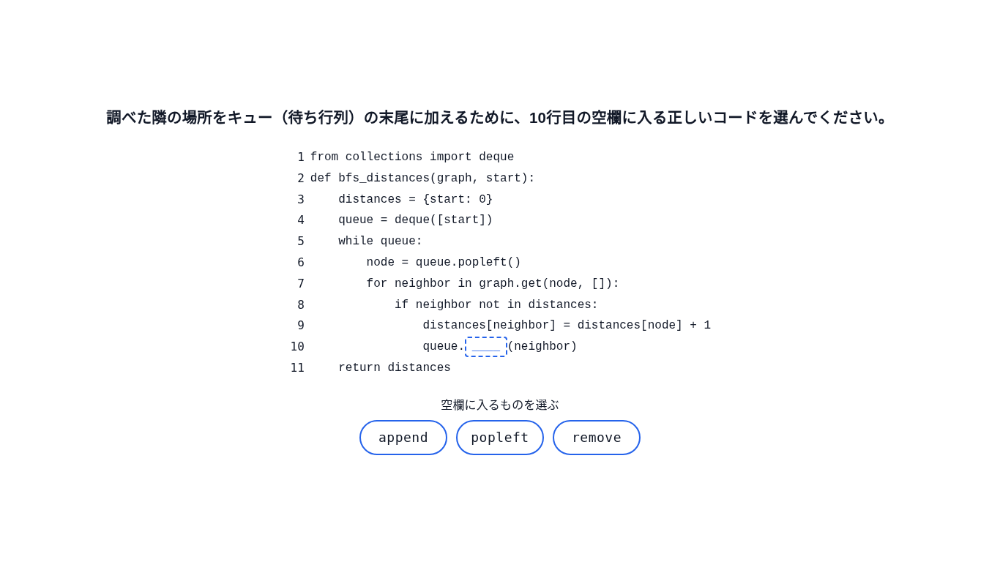
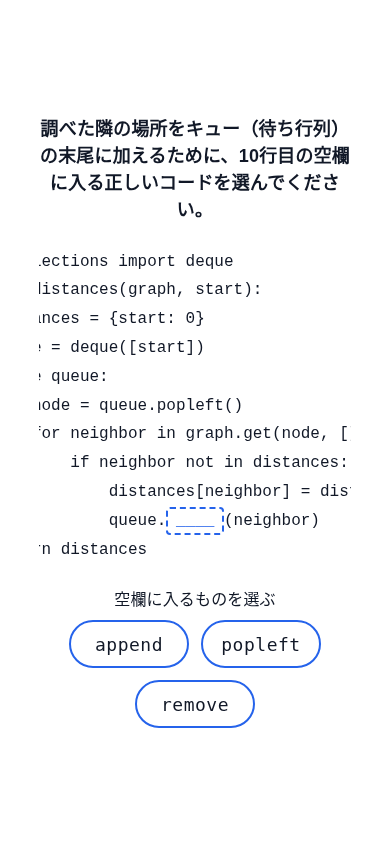
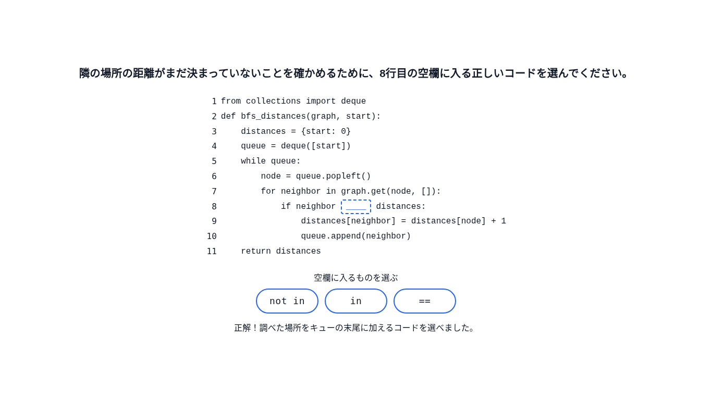
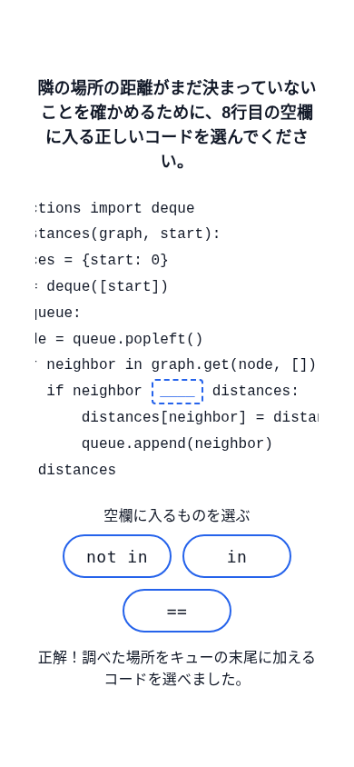
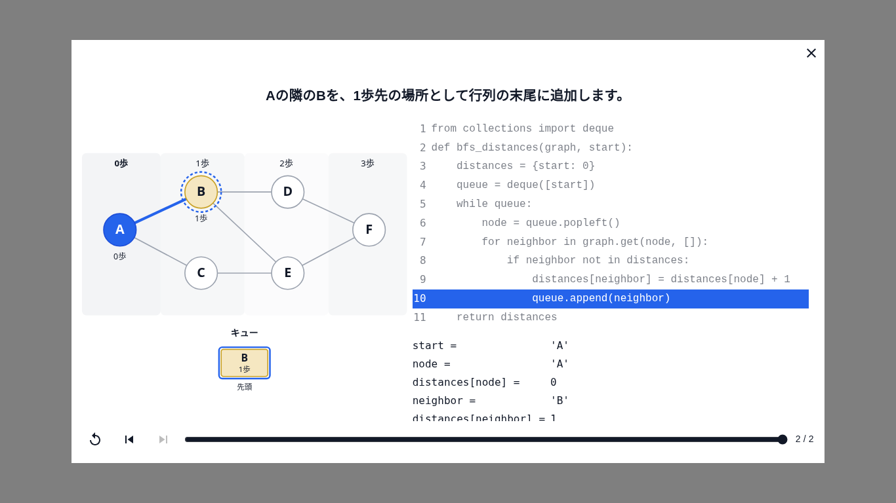
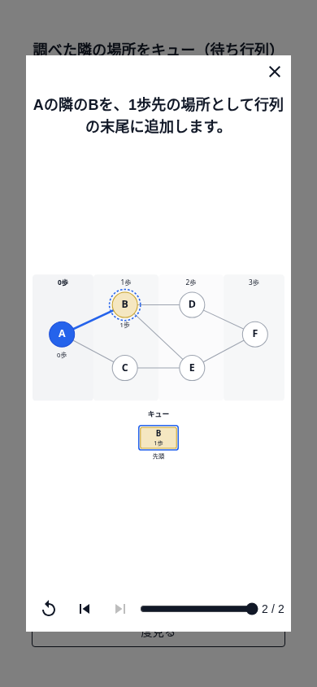
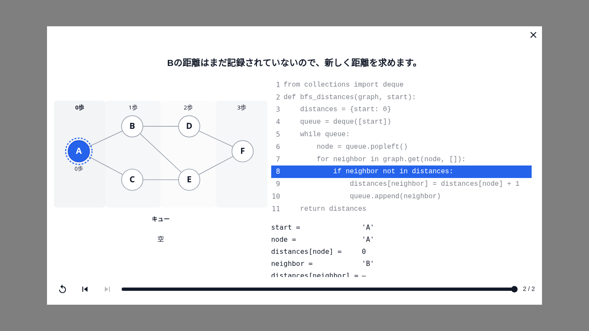
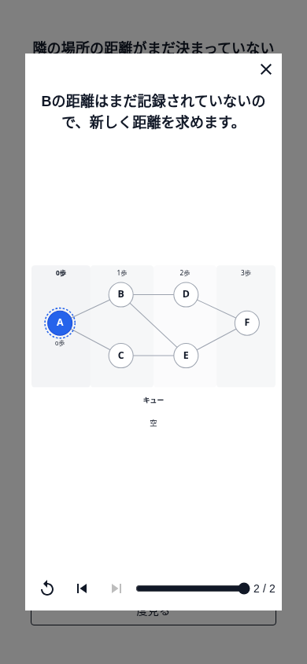
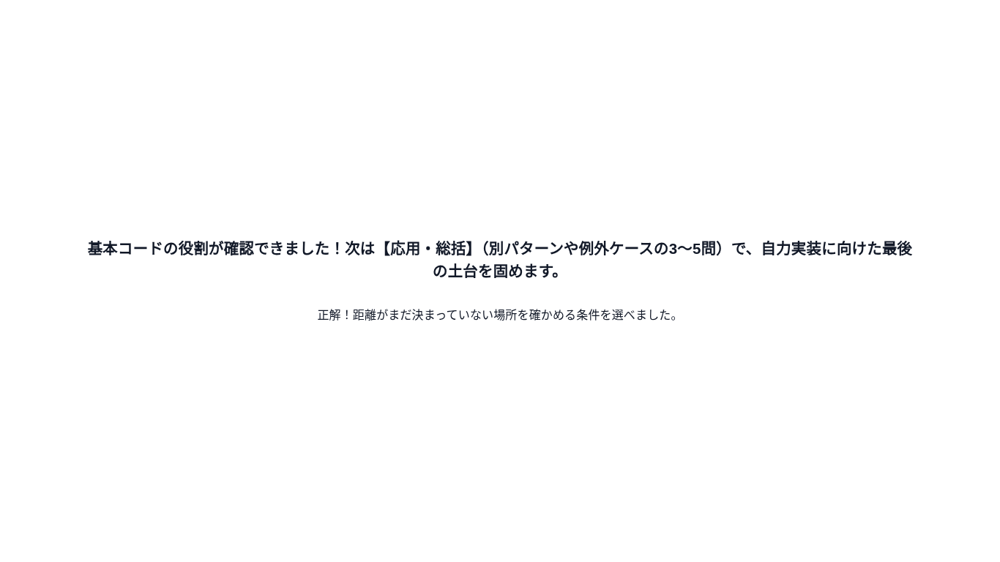
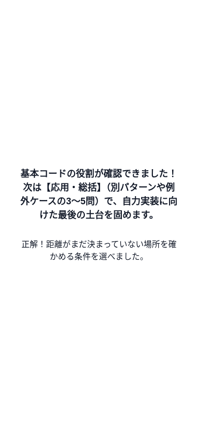

# Issue #73 BFSコード基本確認の実装・検証記録

- 目的: 独立した穴埋め2問、任意復習、タイプCの結果をレビューする。
- 適用範囲: フェーズ5のフロントエンドと既存共通基盤の拡張。状態: 記録。最終確認日: 2026-11-05。
- 起点: `develop` `425215c`（PR #93・#94 マージ済み）。
- 正本: [Issue #73](https://github.com/BeppuKanato/engineer-quest/issues/73)、[教材指針 §1・フェーズ5](concept/learning-materials-guideline.md)、[UI定義](concept/learning-player-ui.md)、[要約](concept/learning-materials-v2.md)。
- データ・共通処理の詳細: [フェーズ5 README](../front/src/features/learning/bfs/code-check/README.md)。

## 実装内容

フェーズ4の `bfsCode`（`bfs-distances-deque`、version 1）に対して、`enqueue-neighbor` のメソッド名と `if-undiscovered` の演算子を問う。
コード本文・意味ID・versionは変更せず、行番号は `bfsCodeLineNumber` から導出する。
両問は `requires: null` の独立した問いで、2問とも正解するまで同じ設問上で再挑戦できる。

`assessment.ts` にコード穴埋め選択を追加し、フェーズ3と同じ順序・初回正誤・全試行・完了・古い回答の拒否処理を使う。
フェーズ4のコード描画を `BfsCodeDisplay` に取り出して両フェーズで共用した。
既存の汎用 `LearningReviewDialog` にフェーズ4の元フレームを渡し、図＋コードの動作を再現する。復習データやセッションの別実装はない。

設問画面は84vw・最小84dvhを基準に、完成済みの11行と1か所の破線の空欄を示す。
選択肢は青い2px枠・18px文字・高さ48px以上のボタンとし、「空欄に入るものを選ぶ」を常時表示する。
390px級ではコード領域だけを横スクロールし、出題時・サイズ変更時に空欄全体を見える範囲へ置く。
結果画面には確認できた具体的な役割と、「応用・総括」で別パターン・例外ケースの3〜5問へ進む予告を示す。フェーズ間接続は作らない。

## 確認方法

`front/` で `npm ci` → `npm run dev` を実行し、起動したマシンのブラウザで `http://localhost:3000/learning-preview/bfs-code-check` を開く。
ログイン・DB・バックエンドは不要。クラウド上のlocalhostは、手元のPCから直接アクセスできる共有URLではない。

1. 問1で popleft を選択し、不正解のまま同じ設問で再挑戦できることを確認する。
2. 任意の復習ボタンを押す。次へ／再生で `assign-a-b` → `execution-discover-b` の図とコード行の変化を確認し、閉じる。
3. append を選ぶ。問1の末尾追加を確認した正解文と問2が表示される。
4. 問2で in を選択し、復習を開く。次へで `for-a-b` → `if-a-b`、対象条件行のハイライトを確認し、閉じる。
5. not in を選ぶ。2問正解で結果画面になり、【応用・総括】と3〜5問の予告が表示される。
6. 再読み込みすると問1の未回答状態へ戻る。Tab＋Enter／Spaceでも回答できる。

## 検証結果

Node.js 20.20.2、Python 3、production buildのChromium。
`front/` で次の9コマンドすべて exit 0:

```bash
npm run lint
npm run typecheck
npm run build
npm run verify:learning-player
npm run verify:bfs-motivation
npm run verify:bfs-execution
npm run verify:bfs-check
npm run verify:bfs-code-mapping
npm run verify:bfs-code-check
```

新verifyで確認したこと:

- 正解を補完した行と元の行のバイト一致、11行の共有コード表示、対象1か所だけの空欄。
- 選択肢のID・文字列が相互に異なること、全6候補の補完後のコード全体がPythonの `ast.parse` に通ること。
- 復習フレームがフェーズ4の元オブジェクトそのものであること、最後の復習行が設問対象の意味IDと一致すること。
- 共通基盤の誤答・再挑戦・初回正誤・全試行・独立性・全問正解での完了・連打／古い回答の拒否。
- ノード選択と選択肢回答が混ざらないこと、不正な空欄・選択肢・行ID・復習先を拒否すること。

ブラウザで確認したこと:

- 1366×768・390×844で、両問の誤答→任意復習→再回答→完了、Tab／Space／Enter、再読み込みでの初期化。
- 選択肢は静止状態でも2px枠があり、高さ44px以上。操作指示は常時表示し、両問とも空欄全体がコード領域内に見える。
- 復習はタップ前に存在せず、開いたモーダルで6ノードの図と対象行のハイライトを再現する。閉じても回答の再挑戦状態は残る。
- ページ全体の横スクロールなし、ページ例外なし。
- 共通assessmentを使う既存フェーズ3も、C→どれも入らないで完了する。
- 共有化したコード表示の退行確認として、フェーズ4を1366×768の全62フレーム、1920×1080・390×844の代表7フレームで再確認。行・変数差分・16px以上の文字・Dim 0.55・図の比率・横スクロールの既存仕様が維持される。

既存のworkspace root・ESLint module type警告は残るが、終了ステータスは成功。DB・外部認証・LLMは変更範囲外。

## スクリーンショット

| 画面 | 1366×768 | 390×844 |
| --- | --- | --- |
| 問1 |  |  |
| 問2と具体的な正解文 |  |  |
| 問1の任意復習 |  |  |
| 問2の任意復習 |  |  |
| 結果と予告 |  |  |

## 判断点

- 指定候補の `queue.popleft(neighbor)` はPythonの構文として成立するが、dequeのpopleftは引数を受けないので実行時の引数エラーになる。指定候補は変更せず、構文成立はASTの検証で確認し、誤答の実行成功を要件に加えない。
- 完了文は「次フェーズの正式名称」を含める要件に従い、指針全文の【応用・総括】を含む例文を使う。
- 復習は既存の共通ダイアログと同様、直前状態から対象行へ手動で進む構成。自動で復習を開いたり、回答状態をリセットしたりしない。

DB適用なし。migration・seed・アプリ組み込み・進捗／ログ保存・フェーズ6・フェーズ間接続は対象外。
