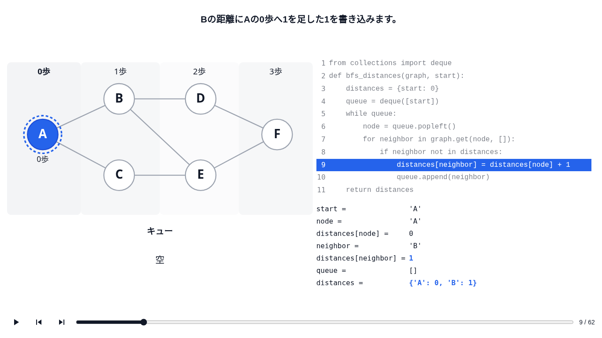
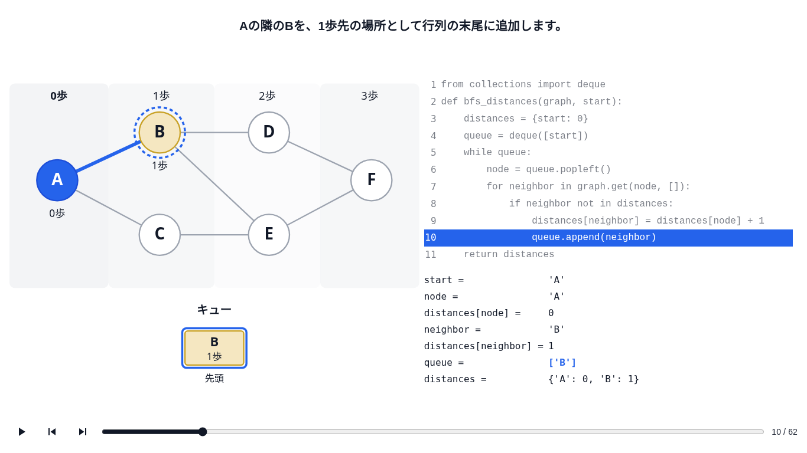
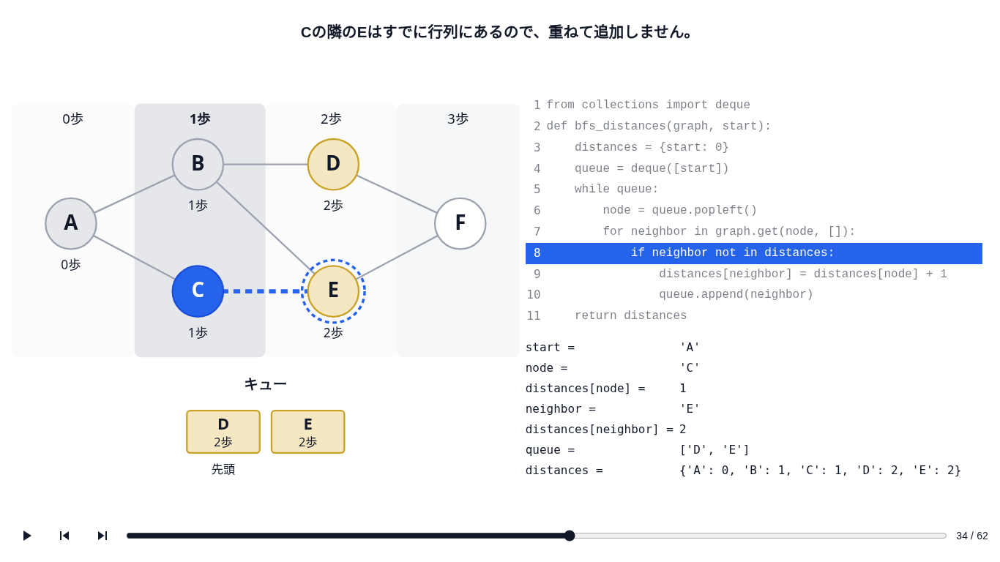
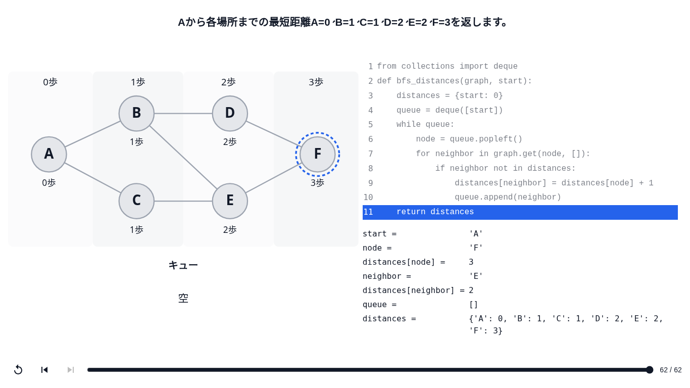
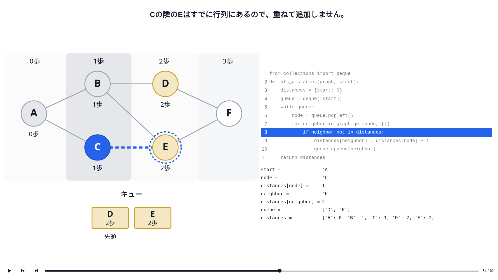
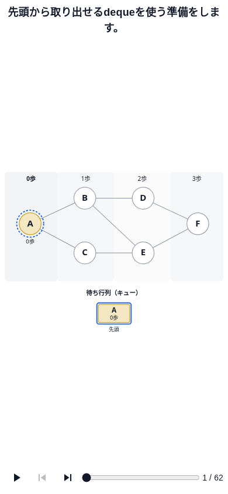
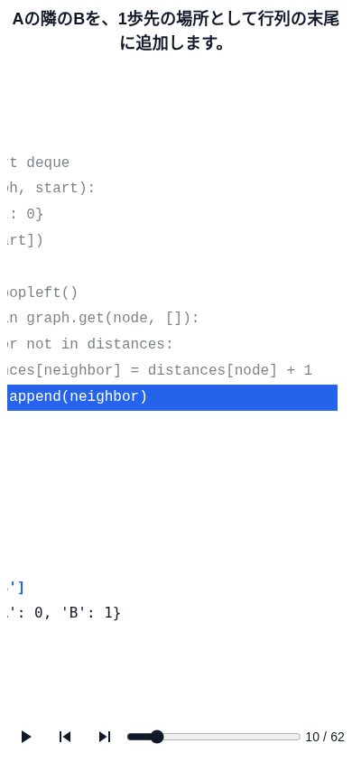

# Issue #72 BFSコード接続の実装・検証記録

- 目的: フェーズ4の単品プレビューと、フェーズ5へ渡すコード契約をレビューする。
- 適用範囲: フェーズ4のフロントエンドのみ。状態: 記録。最終確認日: 2026-11-05。
- 起点: `develop` `402db26`（PR #92 マージ済み）。
- 正本: [Issue #72](https://github.com/BeppuKanato/engineer-quest/issues/72)、[教材指針 §1・フェーズ4](concept/learning-materials-guideline.md)、[UI定義](concept/learning-player-ui.md)、[要約](concept/learning-materials-v2.md)。
- コード契約と詳細: [BFSフェーズ4 README](../front/src/features/learning/bfs/code-mapping/README.md)。

## 実装内容

元の `back/prisma/seedData/breadthFirstSearchCourseSeed.ts` の `breadthFirstSearchAnswerCode`（deque版 `bfs_distances`）を、本文・インデント・変数名を変えずに使う。
`bfsCode` のコードID `bfs-distances-deque`・version 1と11行の意味IDをフェーズ5の参照契約にした。

フェーズ2の19ステップを直接参照するチェックポイントに、宣言、while、forの全反復・終了、ifのtrue/false、距離代入、returnを加え、全62フレームを共通LearningPlayerへ渡す。
元のPythonを実行した順と一致するため、フェーズ2では独立表示しない逆向きの辺や既発見点のifも通過する。
`BfsExecutionCanvas` をそのまま使い、図・プレイヤー・トークンは変更しない。
実行中の行だけ既存トークンの青と白文字、非実行コードはopacity 0.55でDim表示する。コード下部の変数は、直前フレームから変わった値だけ青・太字、その他は黒・通常の太さで表示する。

## 確認手順

ローカルで `front/` の `npm ci` → `npm run dev` を実行し、起動したマシンのブラウザで `http://localhost:3000/learning-preview/bfs-code-mapping` を開く。ログイン・DB・バックエンドは不要。
クラウド環境のlocalhostは、手元のPCから直接アクセスできる共有URLではない。

1. 1〜4コマ目でimport・def・距離初期化・キュー初期化を確認する。
2. 9コマ目でBへの距離代入を確認する。図はまだAを処理中、コード下部にはBの距離1があり、キューは空。
3. 10コマ目でappendと同時に、フェーズ2の `discover-b` の図・強調・キューBへ進む。
4. 34コマ目でC→Eの既発見判定を確認する。8行目が青くなり、図はフェーズ2の `skip-e` と同じ破線とキューD,Eになる。
5. 61→62コマ目でwhileの空判定→returnを確認する。
6. 前後・シーク・Home/End・再生・一時停止・末尾からの再生を確認する。狭い画面では図＋コード領域内を横スクロールでき、操作バーは外側に残る。

## 実行した検証

Node.js 20.20.2、Python 3、production buildのChromium。
以下の8コマンドすべて exit 0:

```bash
npm run lint
npm run typecheck
npm run build
npm run verify:learning-player
npm run verify:bfs-motivation
npm run verify:bfs-execution
npm run verify:bfs-check
npm run verify:bfs-code-mapping
```

新verifyの確認対象:

- 62フレームすべてがフェーズ2の実際のcanvasを直接参照すること（コピーは拒否）。19チェックポイントが順序どおり1回ずつ現れること。
- 11行の意味ID・本文が固定され、元seedのPython本文と一致し、全行がハイライトされること。
- 元のPythonを実際にトレースし、while/for/ifの反復・終了を含む全実行行と、その直後のnode、neighbor、距離、キューがフレームと一致すること。
- 任意順での単独状態の検証、誤った変数値・代入・行ID・チェックポイント欠落を拒否すること。

ブラウザでの確認:

- 1366×768では62フレームすべてのキャプション・実行行・変数表示・図のノード状態を照合。1920×1080・390×844では初期化・代入・追加・既発見・終了の代表7フレームを照合。
- PR #93 の修正後は文字の可読性を優先して図を均等に縮小し、SVGの縦横倍率が等しいことを確認。1366×768・1920×1080では図＋コードが局所スクロールなしで収まる。
- 戻る・進む・Home/End・末尾再生・一時停止を操作し、通常の3500msタイマーで次のフレームへ進むことを確認。
- 別途、3500msの再生タイマーだけをテスト用に60msへ短縮し、62フレームを自動再生して末尾で停止することを確認。製品コード・実際の設定値は変更していない。
- ページ例外なし、ページ全体の横スクロールなし。390pxでは意図した図＋コード領域内の横スクロールあり。

| 画面サイズ | フェーズ2のノード直径 | フェーズ4のノード直径 |
| --- | --- | --- |
| 1366×768 | 83.02px | 69.37px |
| 1920×1080 | 121.52px | 98.18px |
| 390×844 | 37.40px | 37.40px |

既存のworkspace root・ESLint module type警告は残るが、コマンドは成功。バックエンド・DB・外部認証・LLMは検証範囲外。

## スクリーンショット

| 状態 | 画面 |
| --- | --- |
| 距離代入・図は直前を保持（1366×768、9/62） |  |
| 追加・ノードとキューの同期強調（1366×768、10/62） |  |
| 既発見判定（1366×768、34/62） |  |
| 最終return（1366×768、62/62） |  |
| 横長画面（1920×1080） |  |
| 狭い画面・左の図（390×844） |  |
| 狭い画面・横スクロールしたコード側（390×844） |  |

## PR #93 レビュー修正

- コードと変数は `clamp(16px, 1vw, 18px)`、コード行間は1.8。非実行行のopacityは0.55、実行行は青背景＋白文字。
- コード側に幅を確保し、図は共通描画の比率を維持して縮小する。1366×768では横スクロールなし、コードの行切れもなし。
- 変数表示はコンテンツの直前フレームとの差分を表示側で計算する。未代入→値も含め、変わった値だけ `playerTokens.focus` と太字で強調する。その他の変数は黒・通常の太さ・opacity 1を維持。
- キャプションの行番号接頭辞を除去した。19個の実行フレームはフェーズ2の原文そのまま。コード本文・意味ID・version・62フレームの状態・参照・実行行は変更なし。

修正後も上記8コマンドはすべて成功。変更前後の全62フレームを比較し、キャプションの接頭辞以外のデータに差がないことを確認した。
変数の強調判定は、実際のPythonの直前の変数との差分とも全フレームで照合した。

production buildのブラウザで1366×768の全62フレーム、1920×1080・390×844の代表7フレームを確認した。
コード・変数が16px以上、非実行行0.55、変化値が青＋太字、未変化値が黒＋通常の太さ＋opacity 1であることを確認。
任意シーク、逆送り・順送り、サイズ変更後も、9/62の強調対象が `distances[neighbor]` と `distances` に保たれる。

| 画面 | コードの文字／行間 | 図＋コード領域の横スクロール | コードの行切れ |
| --- | --- | --- | --- |
| 1366×768 | 16px／28.8px | なし | なし |
| 1920×1080 | 18px／32.4px | なし | なし |
| 390×844 | 16px／28.8px | 局所スクロールあり | コード領域内での行切れなし |

### レビューで確認するフレーム

上の更新済み1366×768の画像、または単品プレビューで確認する。

1. **9/62（距離代入）**: 横スクロールなしで図とコードが収まり、非実行コードも読める濃さ・大きさになっている。`distances[neighbor] = 1` と距離辞書だけが青・太字で、node・queue等は通常色。
2. **10/62（キュー追加）**: `queue = ['B']` が青・太字へ変わり、距離辞書・距離値は通常色へ戻る。
3. **9/62へ戻る**: シーク・逆送りでも同じ変数の変化表示を復元する。キャプションに「9行目：」等を付けない。

## 判断点と対象外

- フェーズ2は距離代入とappendを1つの図の更新にまとめている。9行目は直前の図を保持し、コード下部の距離辞書だけ実行直後の値を示し、10行目で対応する既存図へ進む。
- 初期化前の図がないため、冒頭の非描画フレームは対応する最初の図を先に示す。コード側の未代入変数は `—` とする。
- PR #93 のレビュー指示に従い、コードの可読性を優先して図を均等に縮小する。1366×768では図＋コードを横スクロールなしで表示し、390px級では局所的な横スクロールを使う。プレイヤー外枠・操作系の既存差分は #83 の範囲で維持する。
- 指針全文のフェーズ4末尾リザルトと要約の4→5シームレス接続は一致していない。今回の明示指示に従い、どちらも #77 の対象外としてreturnで停止する。
- フェーズ5の穴埋め・フェーズ接続・リザルト・アプリ組み込み・保存は実装していない。

DB適用なし。migration・seed不要。既存の19ステップ・グラフ描画・プレイヤー本体・依存関係・ロックファイルは変更なし。
