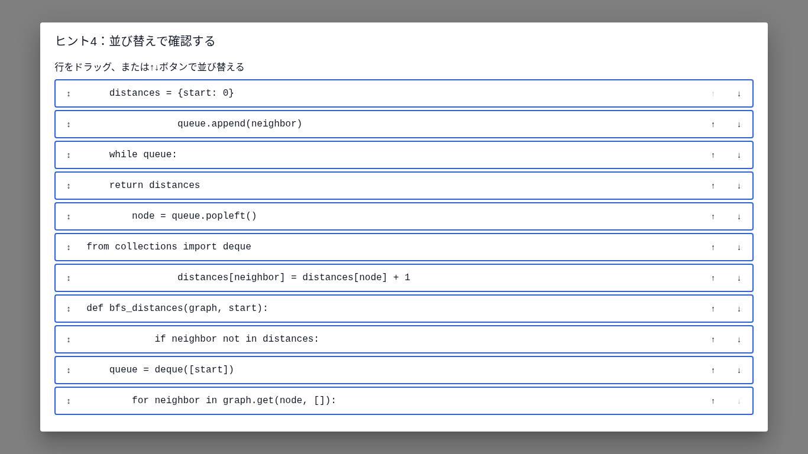
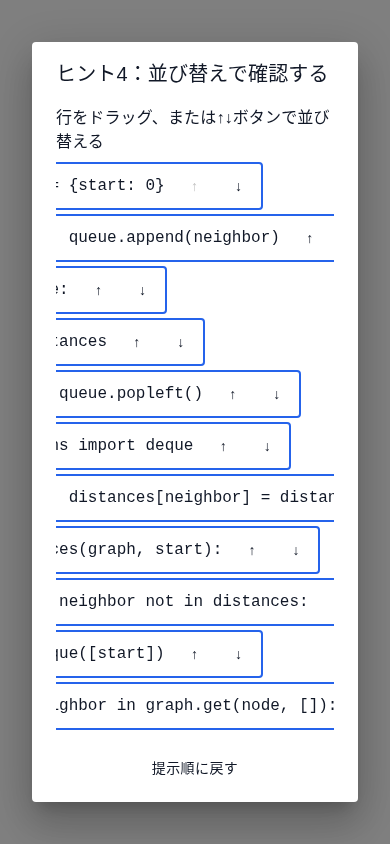
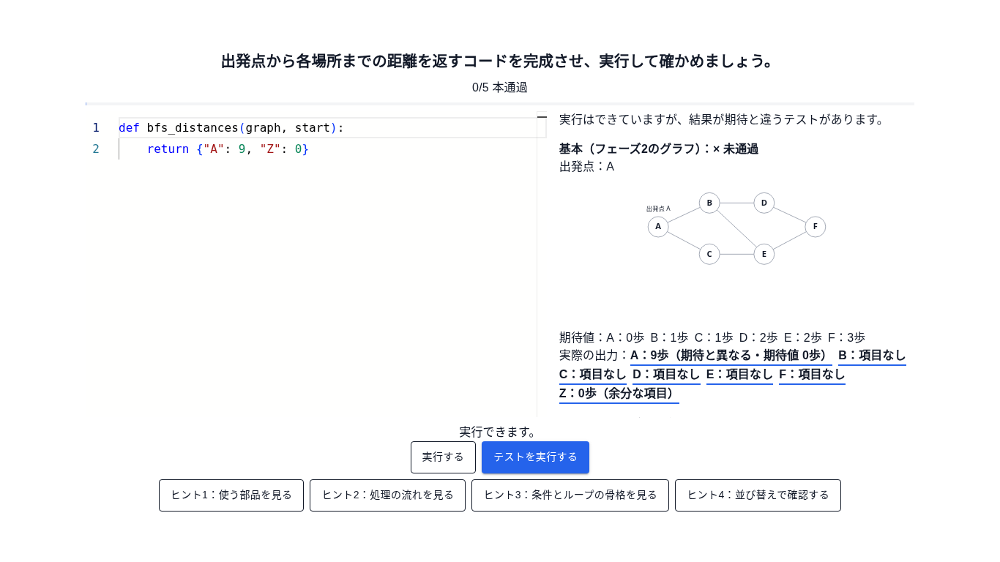
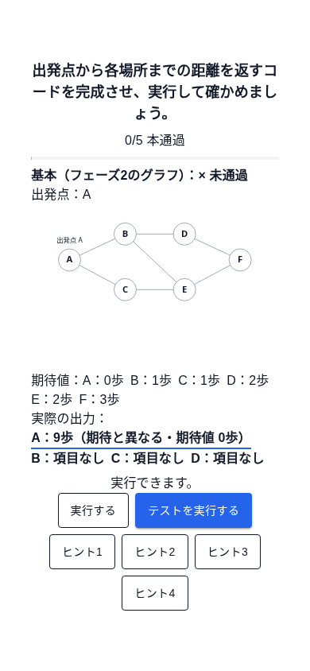
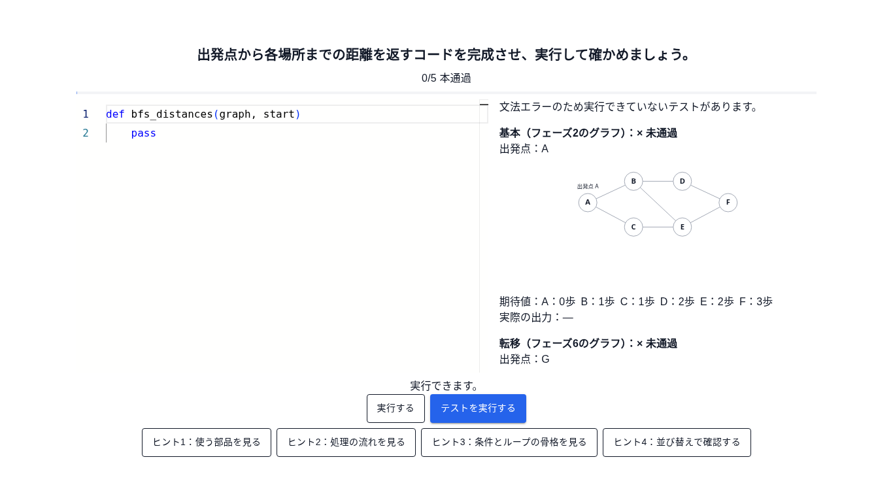
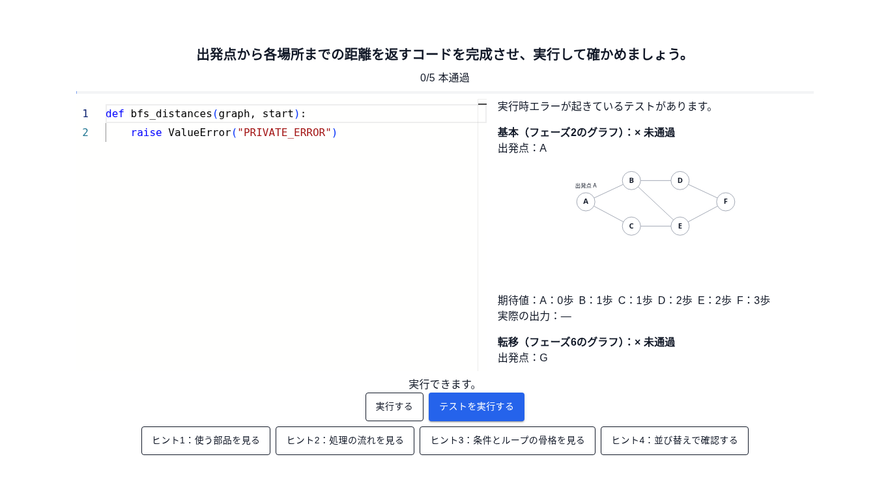
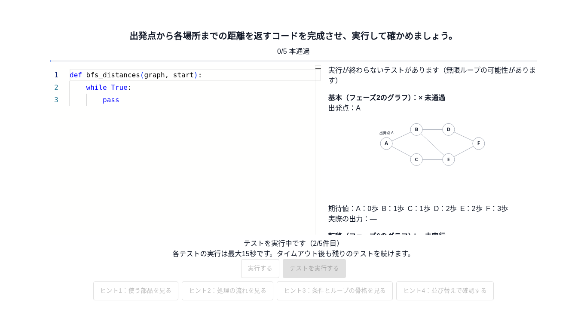
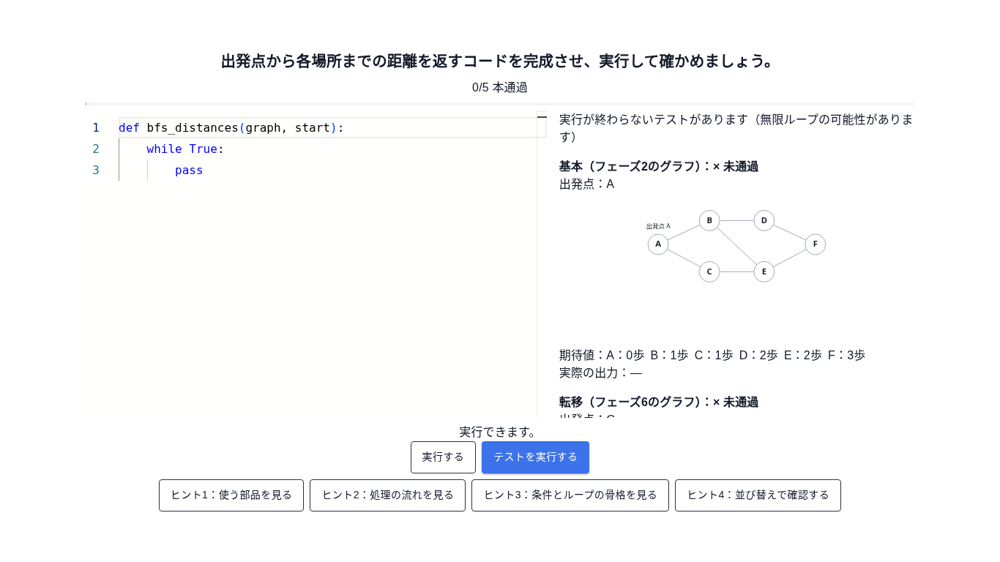

# Issue #75・PR #99 BFS自力実装の実装・検証記録

- 目的: 自由記述・5テスト・ヒント・全通過リザルト、およびPR #99のレビュー修正を確認する。
- 適用範囲: フェーズ7の単品ページ。状態: 記録（4段階ヒントの試行版）。最終確認日: 2026-11-05。
- 起点: `develop` `262cc2b`。レビュー修正の起点: `feat/bfs-implementation-75` `cc93757`。
- 正本: [PR #99とユーザーレビュー](https://github.com/BeppuKanato/engineer-quest/pull/99)、[Issue #75](https://github.com/BeppuKanato/engineer-quest/issues/75)、[教材指針フェーズ7](concept/learning-materials-guideline.md)、[UI定義](concept/learning-player-ui.md)。詳細は[フェーズ7 README](../front/src/features/learning/bfs/implementation/README.md)。

## PR #100で追随した画面

現在は「実行する」でD1の再生を開き、「テストを実行する」で以下の5件を採点する。全通過リザルトは「テスト実行回数」を表示し、「動きを確認する」で再生を再度開ける。再生はテスト実行回数に含めない。テスト内容・4段階ヒント・編集領域は変更していない。
この文書の画像も1366×768・390×844で撮り直した。PR #99当時の実装範囲・検証記録は以下に残し、視覚的デバッグの現行仕様・検証は[Issue #76実装報告](bfs-visual-debug-76.md)を参照する。以下のテスト確認手順の「実行」は「テストを実行する」を指す。

## PR #99での変更

テストの見出しから内部IDを除き、ラベルとアイコン＋「通過／未通過／未実行」で表示する。表示用テストの入力JSONを、既存ConsolidationGraphで描く小さいグラフと出発点に置き換えた。D1は正準bfsGraph、D2はフェーズ6のtransferGraphそのものを参照する。描画・座標・色・比率は共通資産に従う。
期待と実際の距離は「A：0歩」の並びで表示し、値違い・項目不足・余分なキーを文言と下線で識別する。判定用は引き続き種別と合否だけを表示する。

結果欄に文法エラー・実行時エラー・タイムアウト・結果不一致を併記する。未実行時は表示しない。タイムアウトは既存実行器の専用の例外文で判別し、「実行が終わらないテストがあります（無限ループの可能性があります）」と表示する。
実行中は現在のn/5件目と「各テストは最大15秒、タイムアウト後も続行」を表示し、全5件を打ち切らずに実行する。

ヒントを4段階の試行版へ差し替えた。段階式の解放とレベル別利用回数・リザルトは維持する。

1. 使う部品：distances・queueの説明と14トークン。選ぶと閉じてカーソルへ挿入し、編集フォーカスを戻す。常時チップ行を撤去。
2. 処理の流れ：指定された番号付き4項目。
3. 条件とループ：bfsCodeの意味IDから取得したwhile／for／ifの元の3行だけ。本文とインデントを保持する。
4. 並び替え：既存フェーズ6の設問とParsonsBoard、採点なし。

差分ヒントとこの教材内の差分実装は削除した。`diff`パッケージは`course-exam/codeTranscriptionEditor.tsx`でも使われているため保持し、依存とlockfileを変更しない。

## 指針との差と変更しない範囲

指針・Issue本文の3段階ヒント／常時チップ／差分表示に対し、今回のユーザー指示は試行版の4段階構成を求めている。今回の明示指示を優先し、指針本文自体は改訂しない。
テスト入力・期待値・骨組み、bfsCodeの本文・意味ID・version、全テスト通過条件は変更しない。
Monacoのテーマ・文字サイズ・枠と配置、printコンソール、視覚的デバッグ（#76）、アプリ組み込み、保存・ログ送信、フェーズ接続は対象外。DB適用なし。

## 確認方法

`front/`で`npm ci` → `npm run dev`。起動したマシンで http://localhost:3000/learning-preview/bfs-implementation を開く。ログイン・DB・バックエンドは不要。クラウドのlocalhostは共有URLではない。

1. 読込完了後、見出しにD1等がなく、ラベル・状態アイコン・グラフ・出発点・期待距離があることを確認する。判定用3件に図や距離が出ないことも確認する。
2. ヒント1で変数説明と14トークンを確認。カーソルを移してトークンを選ぶと閉じてその位置へ挿入され、Undoで戻せる。
3. ヒント2で4項目、ヒント3で元のインデントの3行だけ、ヒント4で採点なしParsonsを確認する。前のレベルを開くまで次は無効。閉じてもコードを変えず、再度開くと利用回数を増やす。
4. 距離を誤るコードや不足・余分な項目を返すコードを実行し、実際の出力の文言と下線を確認する。文法エラーと実行時エラーを作ると、結果欄の種別が切り替わる。
5. 無限ループを実行するとn/5件目が進み、最大で約75秒かけて全5件が未通過となる。タイムアウトを実行時エラーと別に表示する。
6. 正解に沿うコードで`graph[node]`を使うと4/5件通過し、未登録の隣接情報を扱うケースが未通過になる。`graph.get(node, [])`へ直して再実行し、5/5件と実行回数・4レベル別ヒント回数のリザルトを確認する。
7. 390px幅でも枠内スクロールで全結果を確認できる。再読込ですべて初期化する。

## 検証

Node.js 20.20.2、Python 3。以下11コマンドはすべてexit 0。

```bash
npm run lint
npm run typecheck
npm run build
npm run verify:learning-player
npm run verify:bfs-motivation
npm run verify:bfs-execution
npm run verify:bfs-check
npm run verify:bfs-code-mapping
npm run verify:bfs-code-check
npm run verify:bfs-consolidation
npm run verify:bfs-implementation
```

追加・更新したverifyは、ヒント1のトークン集合、骨格3行の意味IDと元の参照、4段階の解放・回数、教材内の差分実装の不在、他機能のdiff依存の保持、正準グラフとテスト入力の一致、距離の一致・値違い・不足・余分、状態アイコンと内部ID非表示、未実行時の診断なし、タイムアウトの厳密な分類と後続継続、1〜5件目の文言を確認する。従来の5ケース独立BFS・正解のCPython実行・ハードゲート・非公開値の抑止・キャンセルも維持する。

ブラウザは1366×768・390×844で実Monacoと実Pyodideを使用した。トークン選択による閉じる・挿入・編集フォーカス・Undo、4段階の中身と順序、採点なしParsonsの上下操作、距離の3種類の違い、非公開ケースの非描画、4/5→5/5、4レベルの利用回数とリザルト、再読込を確認した。
1366px幅では全5件がタイムアウトするコードで1件目〜5件目を確認し、約75秒で全ケースが未通過となった後も再実行できることを確認した。既存の15秒制限・Workerは変更していない。1366px幅では6回、390px幅では3回実行し、リザルトのヒント回数は両幅ともレベル1〜4で2・1・1・2回と一致した。

### 環境上の制約

初回実装と同じく、このクラウドのChromiumはCDNへの直接読込に証明書制約がある。検証時のみ、HTTPS検証して取得した実Pyodide 0.27.7と、既存node_modulesの同一バージョンMonaco 0.54.0を一時ローカル配信し、資産URLだけを差し替える検証用プロキシを使う。Python実行や判定結果はスタブ化しない。
リポジトリのCDN設定・pyodideRunner・Workerは変更しない。標準CDNからの直接読込は本環境では未確認として区別する。

## PR #100のボタン構成に追随した確認画像

画像は指定viewportで撮影した全ページ画像。枠内の結果一覧は必要に応じてスクロールしている。

| 内容 | 1366×768 | 390×844 |
| --- | --- | --- |
| 初期状態・図と距離 |  |  |
| ヒント1・変数とトークン |  |  |
| ヒント2・4項目の流れ |  |  |
| ヒント3・元の3行 |  |  |
| ヒント4・採点なしParsons |  |  |
| 値違い・不足・余分 |  |  |
| 4/5件・判定用は値なし |  |  |
| 完了・4レベルの回数 |  |  |

| エラーと進捗 | 1366×768 |
| --- | --- |
| 文法エラー |  |
| 実行時エラー |  |
| 2/5件目・タイムアウト後も続行 |  |
| 全5件タイムアウト |  |
