# Issue #75 BFS自力実装の実装・検証記録

- 目的: テンプレートから自由記述し、5テスト・3段階ヒント・全通過リザルトまでレビューする。
- 適用範囲: フェーズ7の単品プレビューとParsonsの採点なし表示。状態: 記録。最終確認日: 2026-11-05。
- 起点: `develop` `262cc2b`（PR #98 マージ済み）。
- 正本: [Issue #75](https://github.com/BeppuKanato/engineer-quest/issues/75)、[教材指針 §1・フェーズ7](concept/learning-materials-guideline.md)、[UI定義](concept/learning-player-ui.md)、[要約](concept/learning-materials-v2.md)。
- 詳細: [フェーズ7 README](../front/src/features/learning/bfs/implementation/README.md)。

## 実装内容

既存Monacoで`bfs_distances(graph, start)`を骨組みから完成させる。14個の補助チップは指定のトークンだけで、現在のカーソル位置へ挿入する。
既存Pyodide基盤で表示用2ケース・判定用3ケースを実行し、1ケースごとに通過数を更新する。判定用は種別と合否だけを描画し、値・標準出力・生の例外を表示しない。
全5ケースを通過するまでは何度でも編集・再実行でき、全通過時に称号・通過数・実行回数・ヒントのレベル別利用回数・単元完了文を表示する。
84vw × 84dvhの枠と16pxのコード文字を保ち、モバイルは枠内スクロールでエディタ・チップ・結果へアクセスする。

ヒントは1→2→3の順に解放する。レベル1は直近の実行の種別だけを示す。レベル2は最新フェーズ6の設問とParsons盤面を再利用し採点しない。レベル3は現在のコードと正本`bfsCode`から得た本文の行差分を、選択・コピー等を抑止した閲覧専用の表に表示する。適用や貼り付けの操作はない。

## 判断点と対象外

- 既存Workerは一括実行の途中で例外が出ると残りの結果を返さないため、同じ`runCourseMissionTests`に1ケースずつ渡す。例外があっても5ケースを試し、結果を逐次更新する。Worker・実行器・15秒タイムアウトの実装は変更しない。
- エラー分類は既存基盤の文字列から行う。文法エラー以外の実行例外・タイムアウトは「実行の途中でエラー」にまとめ、修正指示や生のエラー文は出さない。
- レベル2のためにParsonsの`onAnswer`を任意にし、省略時だけ採点ボタンを隠す。フェーズ6の設問・判定・進行は変えない。
- 判定用データの非表示とレベル3の持ち出し抑止は通常のUIを対象とする。クライアント資産・開発者ツール・画像からの取得を防ぐ仕組みにはしない。
- 指針にある保存・視覚的デバッグ・次アクションの導線は、今回の明示的な対象外に従い実装しない。DB適用なし、依存追加なし、Mission/Activity変更なし。

## 確認方法

`front/`で`npm ci` → `npm run dev`。起動したマシンで http://localhost:3000/learning-preview/bfs-implementation を開く。ログイン・DB・バックエンドは不要。
クラウドのlocalhostは、手元PCから直接開ける共有URLではない。

1. MonacoとPyodideの読込完了を待ち、骨組み・14個のチップ・0/5件の進捗・5ケースの一覧を確認する。
2. カーソルを移してチップを押し、その位置への挿入とUndoを確認する。チップは式や文を補完しない。
3. 骨組みのまま実行すると通過せず、リザルトへ進めない。ヒント1では結果不一致の種別だけを表示する。
4. ヒント2を開き、既存Parsonsの行をドラッグまたは上下ボタンで動かす。採点ボタンは出ず、閉じてもエディタのコードは変わらない。
5. ヒント3で現在のコードと正解本文の行差分を確認する。正解側の文字選択・コピーや、エディタへ適用する操作はない。
6. BFSを記述し、隣接参照を`graph[node]`にするとJ3で例外となり4/5件になる。J1〜J3に入力・期待値・実際の出力が出ないことを確認する。
7. `graph.get(node, [])`で未登録の隣接情報を扱えるようにして再実行し、5/5件とリザルトを確認する。実行回数・各レベルの利用回数も確認する。
8. 再読込で骨組み・0回・未解放ヒントに戻る。別途、文法エラーと実行時エラーを作ってヒント1の区別を確認できる。

## 検証結果

Node.js 20.20.2、Python 3、production buildのChromium。次の11コマンドすべてexit 0。

```bash
npm run lint
npm run typecheck
npm run build
npm run verify:learning-player
npm run verify:bfs-motivation
npm run verify:bfs-execution
npm run verify:bfs-check
npm run verify:bfs-code-mapping
npm run verify:bfs-code-check
npm run verify:bfs-consolidation
npm run verify:bfs-implementation
```

新verifyでは全5件の期待値を独立BFSで再計算し、指定された入力と一致することを確認。テンプレート構文、14トークンの厳密一致、正本コードとの一致とCPythonでの5件通過、段階式ヒントと回数、行差分、判定用非表示、ハードゲート、例外後の後続ケース・進捗・キャンセルを検証した。

実ブラウザでは1366×768・390×844で、Monacoでの編集・カーソルへのチップ挿入とUndo、ヒントの順序制限と各モーダル、採点なしParsonsの上下移動、差分コピーイベントの抑止、4/5→5/5、リザルト、再読込による初期化を確認した。
1366px幅では骨組み・文法エラー・実行時エラー・部分通過・15秒タイムアウト・正解の6回を実行し、タイムアウトでWorkerが破棄された後も再実行で5/5件通過した。390px幅では部分通過→正解の2回。生の例外と判定用の値の非表示、API・保存処理なし、ページ例外・横はみ出しなしも確認した。
390px幅ではチップ領域と結果一覧が重ならないこと、およびJ1〜J3を含む全結果へ枠内スクロールで到達できることを要素の位置でも確認した。

### ブラウザ検証時の環境上の制約

このクラウドのChromiumは、プロキシ経由のCDN証明書を信頼できずMonacoとPyodideの直接読込に失敗した。永続的な信頼ストアへのCA追加は自動承認審査で拒否されたため、設定変更は行っていない。
検証時のみ、HTTPS検証を有効にしたcurlでPyodide 0.27.7の実資産を取得し、既存node_modulesの同一バージョンMonaco 0.54.0とともに一時ローカルサーバーから配信した。production buildの検証用プロキシはCDN資産のURLだけをローカルへ置き換えた。Python実行や判定結果のスタブは使っていない。
リポジトリのCDN設定・Worker・pyodideRunnerは変更していない。標準CDN経由の直接読込は、この環境では未確認として区別する。

## 確認画像

| 画面 | 1366×768 | 390×844 |
| --- | --- | --- |
| 骨組み・チップ・テスト | 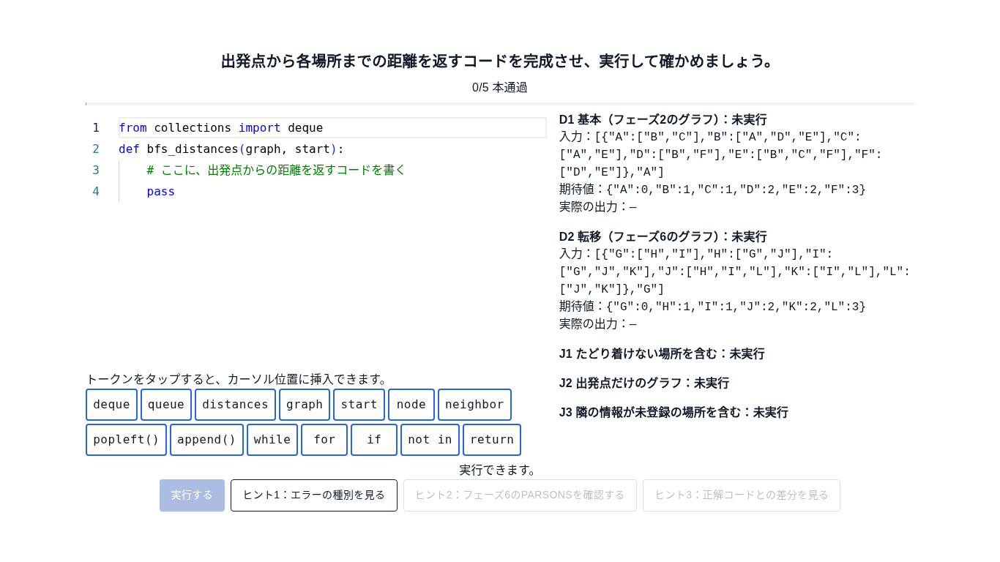 | 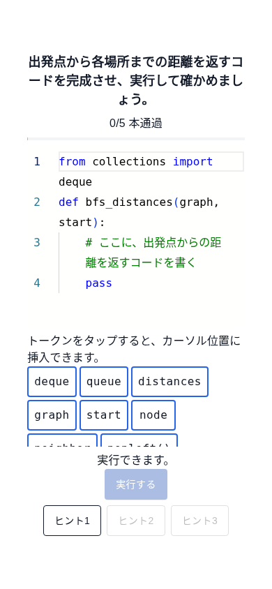 |
| ヒント1 | 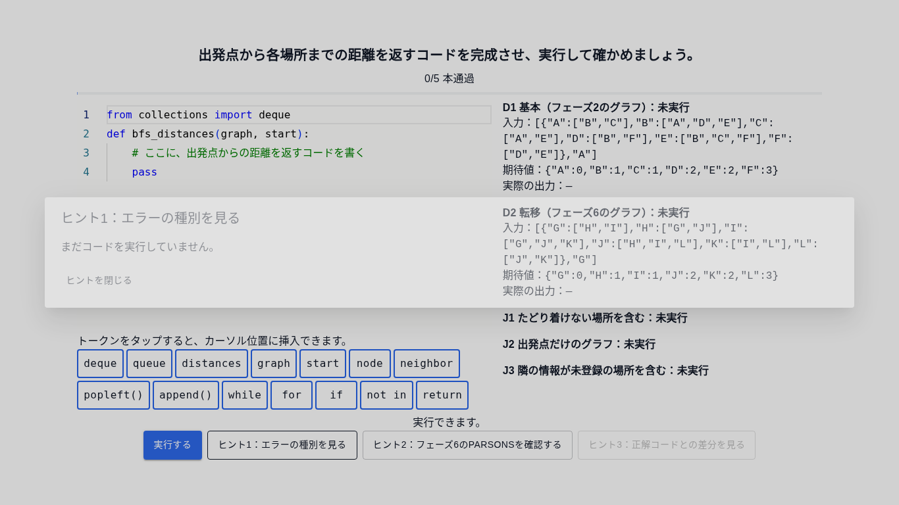 | 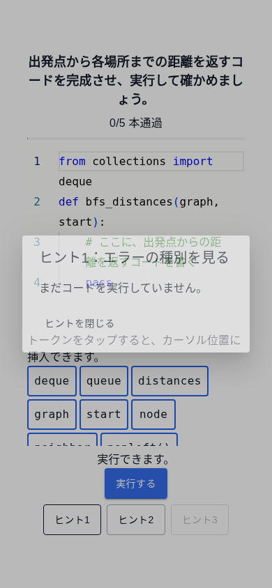 |
| ヒント2・採点なしParsons | 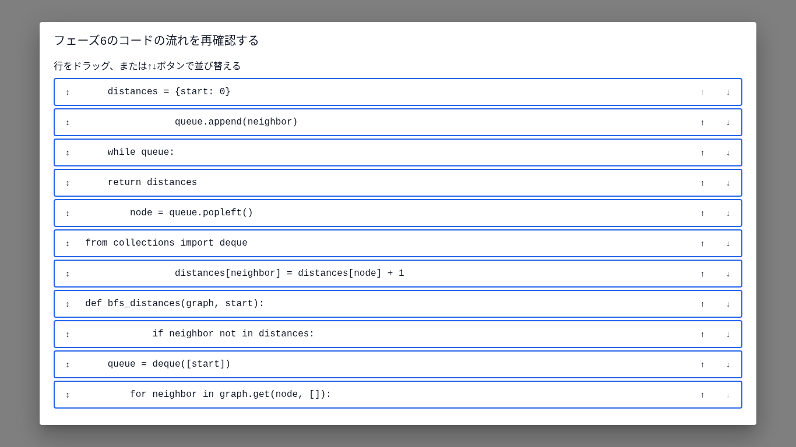 | 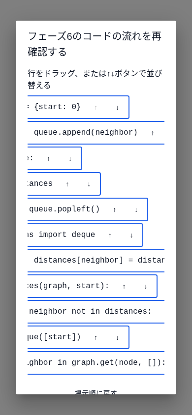 |
| ヒント3・行差分 | 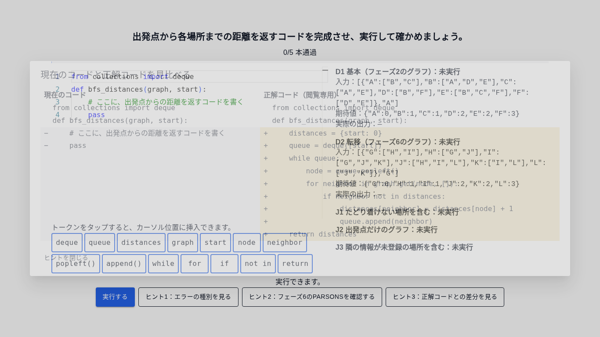 | 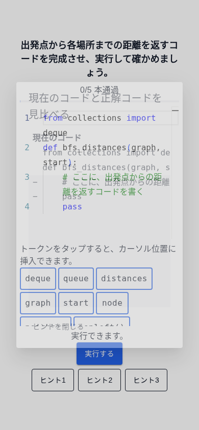 |
| 4/5件で継続 | 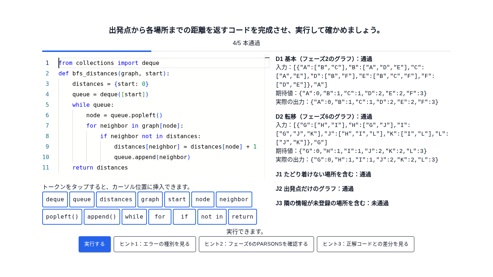 | 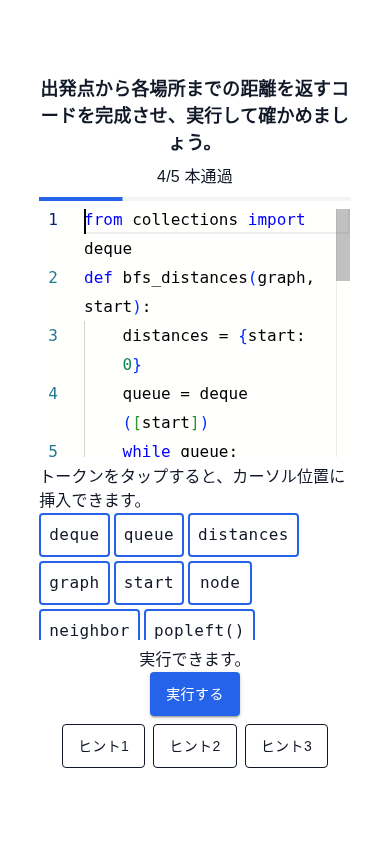 |
| 全通過リザルト | 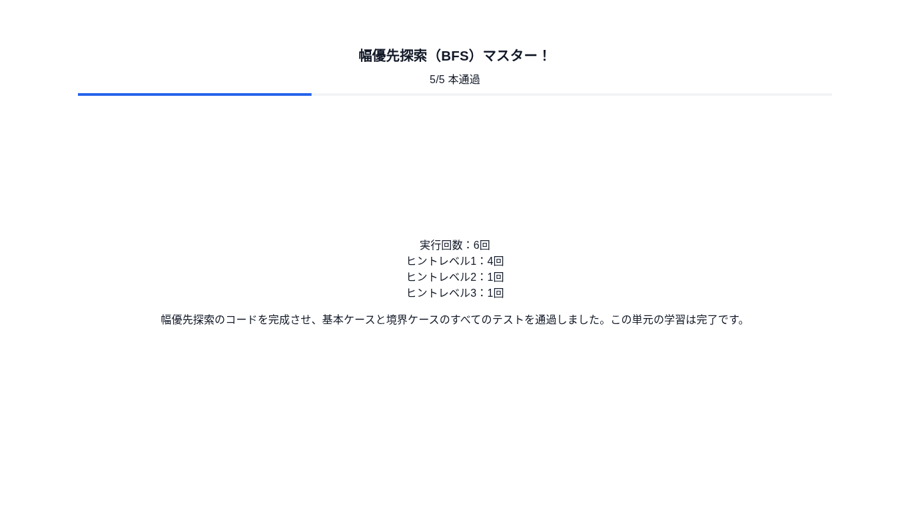 | 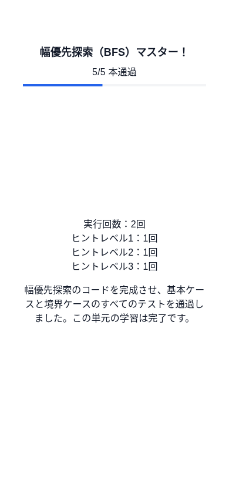 |
