# Issue #76 BFS視覚的デバッグの実装・検証記録

- 目的: 学習者の現在のコードをD1でトレースし、再生・停止・打ち切り・最終状態表示を確認する。
- 適用範囲: フェーズ7の単品ページ、再利用可能な取得・変換モジュール、共通Workerのtrace経路。状態: 記録。最終確認日: 2026-11-05。
- 起点: `develop` `6d013f4`（PR #99マージ済み）。
- 正本: [Issue #76](https://github.com/BeppuKanato/engineer-quest/issues/76)、[教材指針 §1・7-3](concept/learning-materials-guideline.md)、[UI定義](concept/learning-player-ui.md)。詳細は[trace README](../front/src/features/learning/bfs/trace/README.md)。

## 実装

PR #100レビュー修正後は、編集画面の「実行する」でD1をトレースしてプレイヤーを開き、「テストを実行する」で5件を採点する。全通過リザルトからは「動きを確認する」で再生を開ける。リザルトの回数表記は「テスト実行回数」で、トレースを含めない。取得中はコード編集・採点・ヒント・重複実行を無効にし、状態を表示する。トレースの利用で採点実行回数・ヒント回数を変更しない。

既存pyodideRunner／Workerにkind=traceを追加した。Pythonのsys.settraceで対象関数の行・return・exceptionイベントを記録し、queue・distancesを優先名または型・内容で検出してコピーし、node・neighborだけは名前で取得する。優先名がなければ、キュー候補は文字列だけのdeque／list／tuple、距離候補は文字列キー・有限数値のdict。複数候補を推測で選ばず最終状態表示へ落とす。停止行と例外種別、既定500イベントの上限、打ち切りを返す。stdout・stderr・例外本文・トレースバックは渡さない。
取得は毎回新しいWorkerで行い、表示用D1の関数名と引数だけを送る。前の判定用ケースを含むWorkerや、tests・期待値・他ケースの入力を持ち込まない。

変換は別モジュールとし、正しいBFSを再実行して置き換えず、実際のキュー・距離・現在の場所からフェーズ2と同じ状態形式を生成する。既存BfsExecutionCanvasとLearningPlayerで再生し、下部に観測行・queue・distances・nodeを表示する。キャプションは状態の差分から機械生成する。

## 対応付け・判断点

- **ユーザー確認済み**: 行トレースの距離代入直後とキュー追加後を1コマへまとめ、検出したキュー変数名を条件に含むwhileの境界に「調べ終えた」状態を補う。生の変数値は保持するため、図で完了した場所のnode変数がPythonには残っている場合がある。
- 正解コードの状態列は、フェーズ2の正準19コマから同一状態のskip-eを間引いた18状態と一致する。最終の同一状態は終了・停止・打ち切りのキャプションへ更新する。
- 誤った数値やLIFOの順序も描くため、正しいBFS専用のvalidateBfsExecutionCanvasは適用せず、同じ型と描画可能性を検証する。誤距離と正準の距離帯が矛盾するときだけ帯を外し、ノード・辺・座標・表示値は変えない。
- D1の既知6点、重複のない最大6件のキュー、数値の距離辞書が描画範囲。個別の無効な状態は飛ばし、無効な末尾があっても変換できたフレームを保持して途中まで再生する。途中の無効状態から回復すれば通常再生を続ける。候補が曖昧、再帰など異なる構造、または有効なフレームがない場合は最終状態モードへ落とす。返り値の数値辞書からD1上の距離を描くが、返り値からローカル変数を作って表示しない。再帰例のresult辞書は実在する距離候補として検出できるので変数欄にも表示するが、キューがないため再生は行わない。
- エラー時はそこまでの状態を保ち、最後を停止行・種別のフレームにする。変換不能でも停止行と種別は表示する。最終状態モードは1フレームで再生操作を無効にする。
- トップレベルの試し呼び出しは記録・イベント上限を消費しない。exec後に記録対象をリセットし、ハーネスのD1呼び出しだけを記録する。トップレベル例外でも関数定義済みならD1を実行し、未定義なら元の停止行・種別を返す。Codex P2の提案はトップレベルもイベント制限対象としていたが、今回のユーザー指定を優先し、トップレベルはWorkerの時間上限だけに委ねる。
- 1イベントのコピーはコレクション64件・文字列100文字まで、記録は既定500件（APIの上限2000件）。上限を捕捉して処理が戻った場合も、打ち切りを成功扱いにしない。
- 時間上限は既存の15秒。ネイティブ処理などで時間切れになるとWorkerが破棄され、そこまでの記録は取り出せない。その場合は再生せずタイムアウトと記録を取得できなかったことを表示し、新しいWorkerで再試行できる。

bfsCodeの本文・意味ID・version、フェーズ7のテスト・4段階ヒント、フェーズ2のステップデータ、キャンバスとプレイヤー本体は変更していない。DB適用なし。エディタ改善・printコンソール・保存・他フェーズへの組み込み・接続は対象外。

## 確認方法

`front/`で`npm ci` → `npm run dev`。起動したマシンのブラウザで http://localhost:3000/learning-preview/bfs-implementation を開く。ログイン・バックエンド・DB不要。クラウドのlocalhostは共有URLではない。

1. MonacoとPyodideの読込完了を待つ。正解に沿ったbfs_distancesを書き、「実行する」を押す。
2. モーダルで再生・一時停止・前後・シーク、矢印／Home／Endを操作する。Bを追加した状態ではqueue=[B]、distances={A:0,B:1}、node=Aと図が一致する。最後は6点の距離と空のキューになる。
3. 10行目相当の追加行を`raise ZeroDivisionError("任意の本文")`へ置き換えて確認する。そこまでの状態と停止行・ZeroDivisionErrorを表示し、本文・トレースバックは出ない。
4. 下の再帰例を貼り付けて確認する。再生を行わない1フレームになり、返された距離だけを描き、「結果だけを表示します」を明示する。
5. queueを減らさないループを実行し、途中までの表示と打ち切りを確認する。`time.sleep(20)`等のネイティブ処理では15秒後に記録なしのタイムアウトとなる。
6. 閉じてもコード・採点・ヒント利用状態は変わらない。再試行や「テストを実行する」で通常の5テスト実行が可能で、全通過後は「動きを確認する」から同じコードを確認できる。テスト実行回数には再生を含めない。

追加の回帰確認（いずれも「実行する」）:

- 正解コードの`queue`を`que`、または`queue`／`distances`を`q`／`dist`へ改名する。同じ18状態と最後のD1距離を確認する。
- 関数定義の下へ`bfs_distances({"A": []}, "A")`を残す。Aだけの試し呼び出しではなくD1の6点が再生される。代わりにトップレベルで例外を発生させても定義済みの関数でD1を再生する。
- 改名したキューとは別に文字列リストの候補を追加する。推測で選ばず「結果だけを表示します」となる。
- 正解コードのreturnの直前へ`queue.extend(["A", "A"])`を追加する。有効な18状態を残し、最後に「途中まで表示します」を表示する。

再帰での最終状態表示を確認する例:

```python
def bfs_distances(graph, start):
    result = {start: 0}
    def visit(node):
        for neighbor in graph.get(node, []):
            if neighbor not in result or result[neighbor] > result[node] + 1:
                result[neighbor] = result[node] + 1
                visit(neighbor)
    visit(start)
    return result
```

打ち切りを確認する例:

```python
from collections import deque
def bfs_distances(graph, start):
    distances = {start: 0}
    queue = deque([start])
    while queue:
        node = queue[0]
```

## 検証結果

Node.js 20.20.2、Python 3、production buildのChromium。以下12コマンドすべてexit 0。

```bash
npm run lint
npm run typecheck
npm run build
npm run verify:learning-player
npm run verify:bfs-motivation
npm run verify:bfs-execution
npm run verify:bfs-check
npm run verify:bfs-code-mapping
npm run verify:bfs-code-check
npm run verify:bfs-consolidation
npm run verify:bfs-implementation
npm run verify:bfs-trace
```

新verifyではWorkerと同じハーネスをCPythonで実行し、正解・listキュー・初期化順交換と正準の18状態一致、LIFOの実際の順序、誤距離、スナップショットのコピー、途中・末尾のエラー停止行、再帰の最終状態、構文エラー、改名que／q・distと正準18状態、優先名・曖昧候補、トップレベル試し呼び出しと多数呼び出し・定義前後の例外、無効末尾の部分再生・回復、上限・捕捉された上限、D1だけの送信とWorker分離・キャンセルを確認する。

PR #100修正後の実ブラウザの1366×768・390×844では、改名2パターン・試し呼び出し・トップレベル例外でD1の18状態、候補曖昧時の最終状態、無効末尾の部分再生、新しい2ボタンと完了後の再生導線、閉じた後のコード・テスト結果の保持、通常18状態、変数・シーク・再生、途中エラーの10行目と種別、再帰の最終状態、変換不能エラー、上限超過、閉じても状態を保持することを確認した。判定用テストで失敗した後も、新規WorkerへD1だけを送ることを送信メッセージで確認。トレースは採点・ヒント回数を増やさず、通常採点は4/5→5/5へ進める。
1366px幅でネイティブ処理の15秒タイムアウトとその後の再試行も確認した。実Workerで既存ping・run・runCreateQuestと通常runのstdoutが維持されることも確認した。

### 環境上の制約

PR #99と同じCDN証明書の制約があるため、ブラウザ検証ではHTTPS検証して取得済みの実Pyodide 0.27.7と、同じバージョンMonaco 0.54.0を一時ローカル配信している。検証用プロキシは資産の取得先だけを置き換え、Python実行や判定結果はスタブ化していない。リポジトリのCDN設定は変更せず、標準CDNからの直接読込は本環境では未確認として区別する。

## 確認画像

| 内容 | 1366×768 | 390×844 |
| --- | --- | --- |
| ボタンと通常画面 | 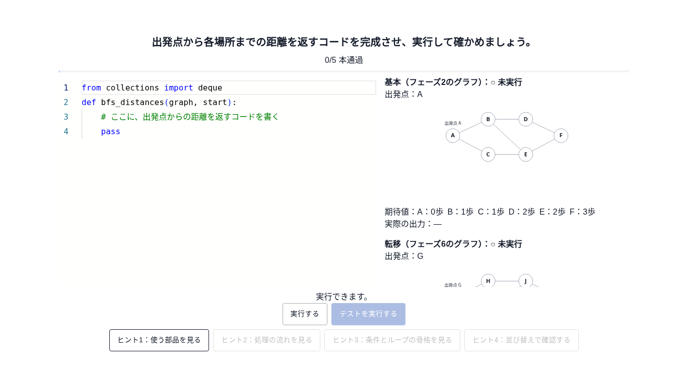 | 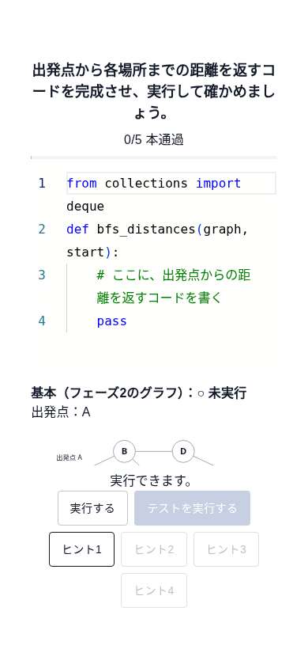 |
| 再生の初期状態 | 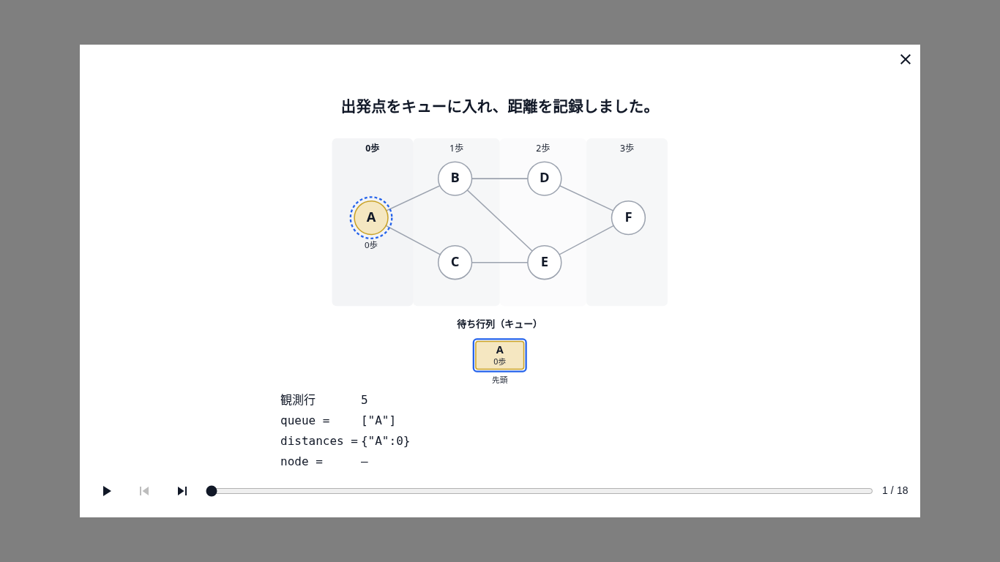 | 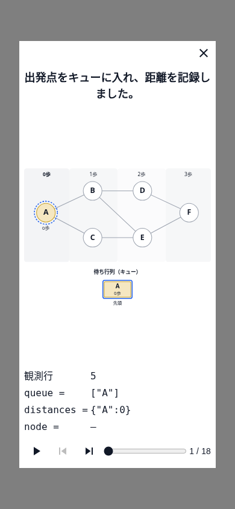 |
| 図と変数の同期 | 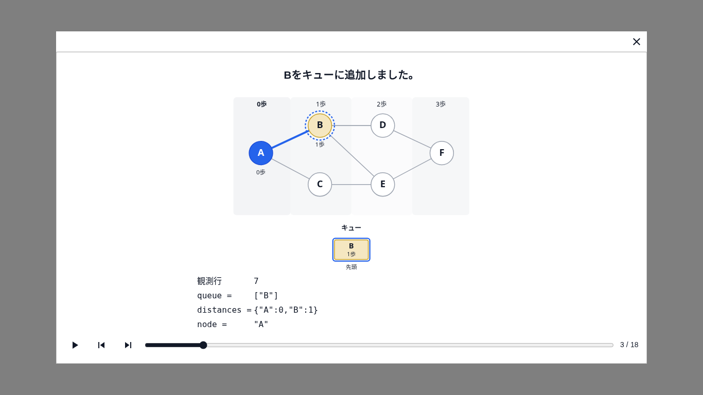 | 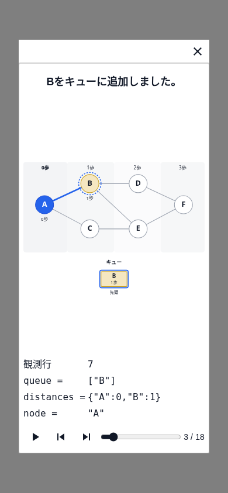 |
| 最後の距離と空のキュー |  |  |
| 停止行・種別 | 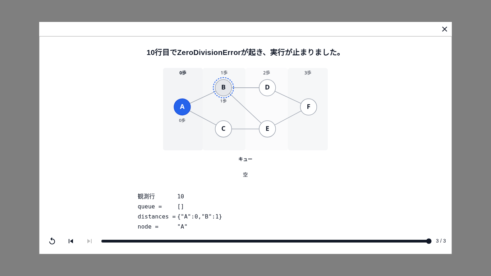 | 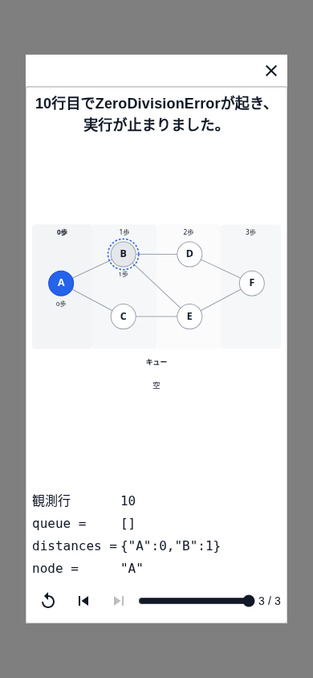 |
| 再帰の最終状態のみ | 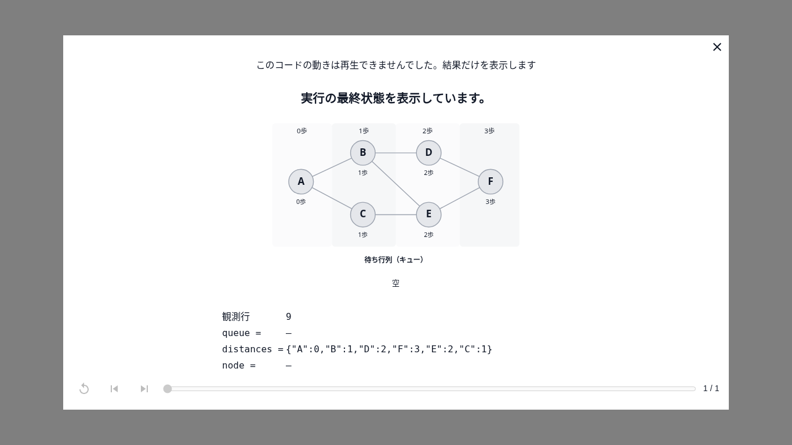 | 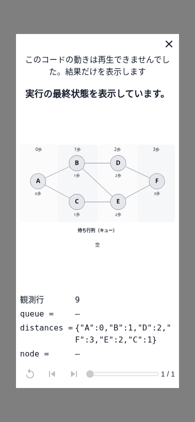 |
| 変換不能時のエラー | 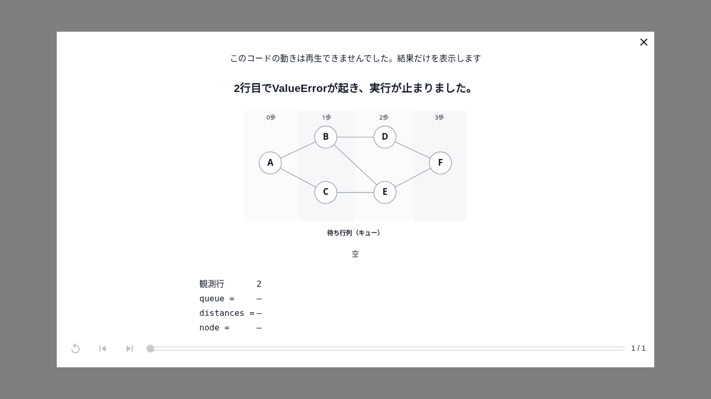 | 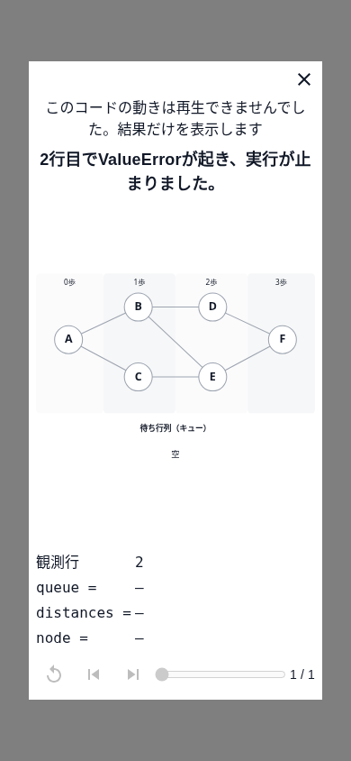 |
| queへの改名 | 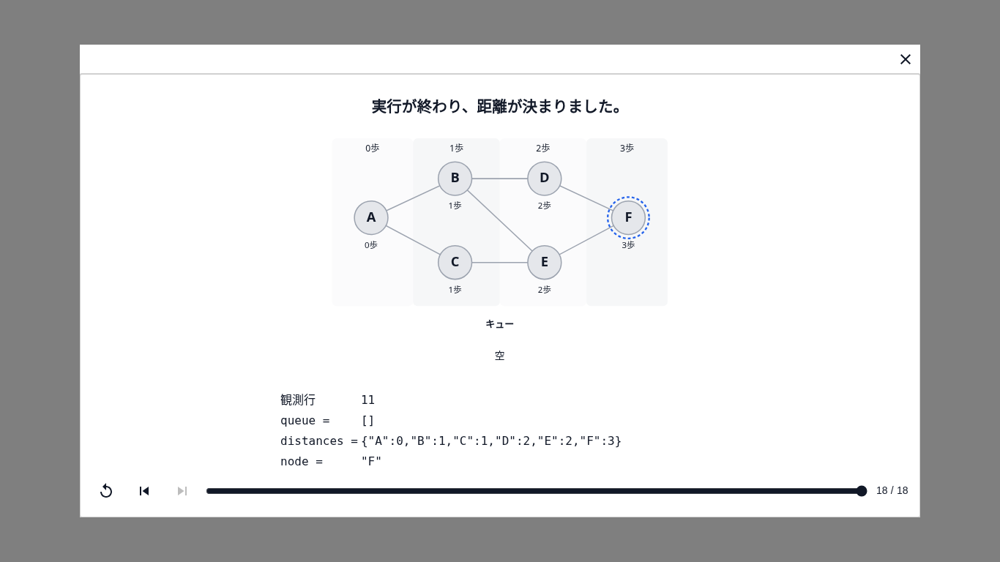 | 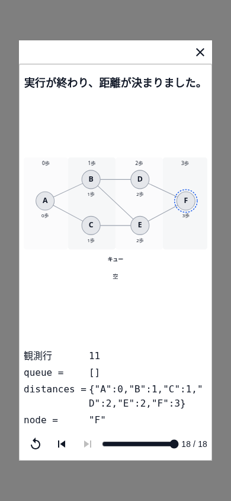 |
| q／distへの改名 |  |  |
| 試し呼び出しを除外したD1 |  |  |
| トップレベル例外後のD1 |  |  |
| 候補が曖昧なら最終状態 | 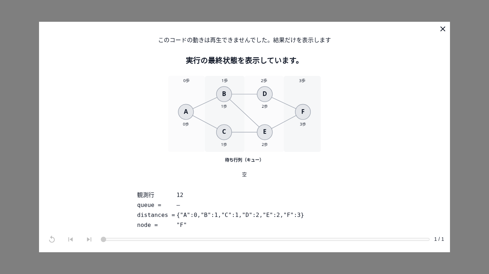 | 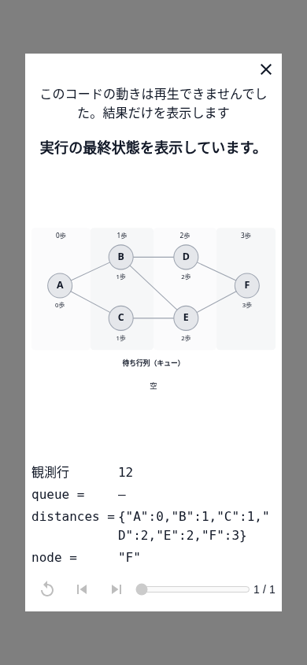 |
| 無効な末尾でも部分再生 | 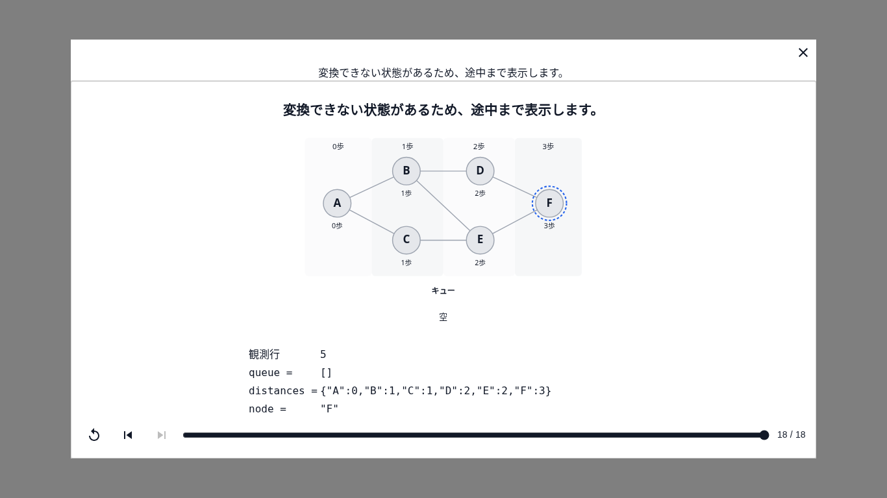 | 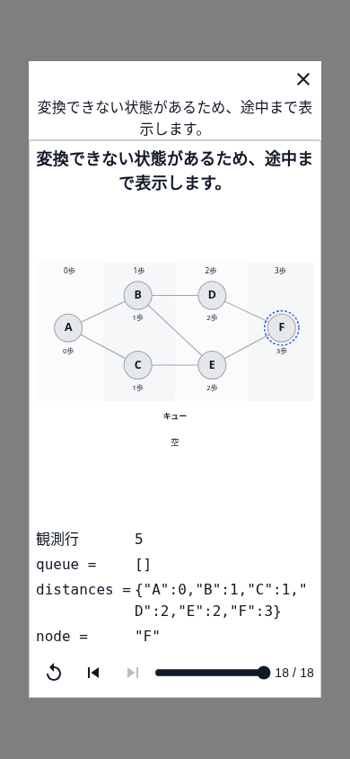 |
| 上限での打ち切り | 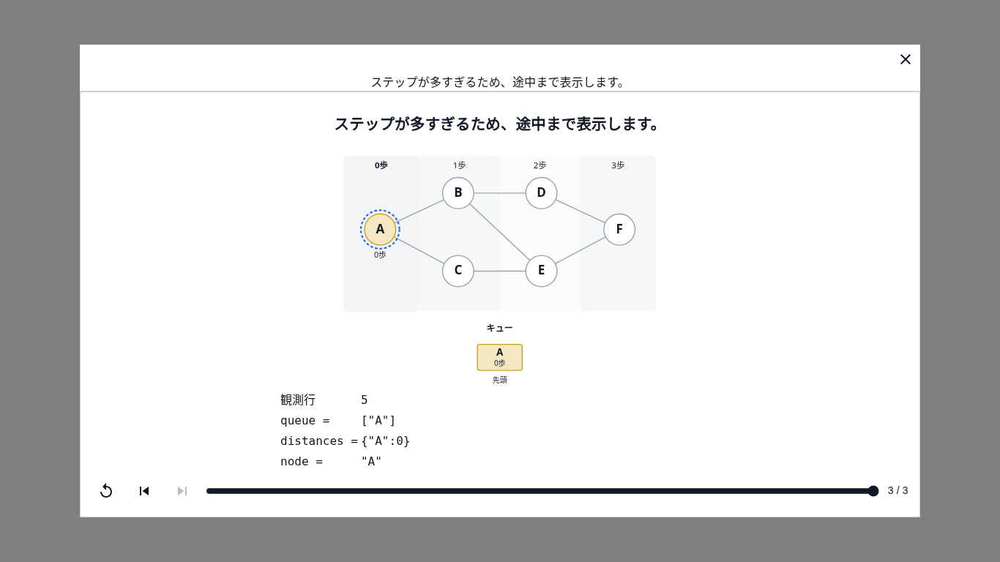 | 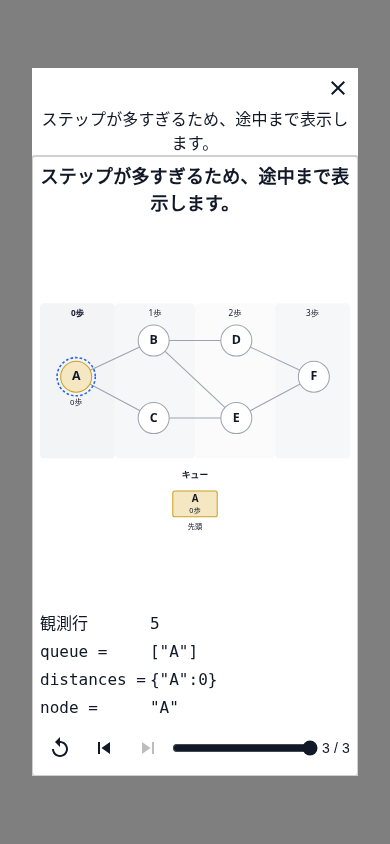 |

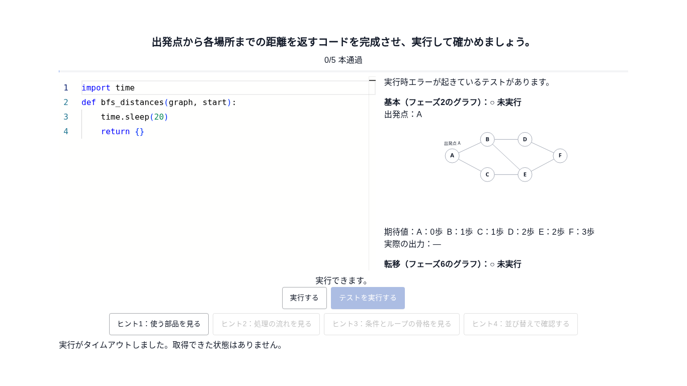
