# Issue #91 グラフ描画統一の検証記録

- 目的: 土台・BFS フェーズ1・2・3の描画統一をレビューできるようにする。
- 適用範囲: フロントエンドの描画・迷路配置。状態: 記録。最終確認日: 2026-11-05。
- 起点: `develop` `a4a7e16`（PR #90 マージ済み）。
- 正本: [Issue #91](https://github.com/BeppuKanato/engineer-quest/issues/91)、[UI定義 §2.3](concept/learning-player-ui.md#23-グラフの描画と拡縮issue-91)、[教材指針 §1](concept/learning-materials-guideline.md#1-共通プロダクトuiux絶対制約全アルゴリズム共通)。

## 実装と判断点

`GraphDrawing.tsx` の GraphViewport / GraphEdges / GraphNodes と `graphGeometry.ts` に描画を集約した。
半径30、枠線2、辺2/5、半径37・線幅3・破線5 4の強調リング、ラベル24を全キャンバスで使う。
600×450の論理座標のSVG全体を等倍比で拡縮し、ノードの拡大強調と画面幅に応じた座標の引き伸ばしを廃止した。
キューの出入りも正本のノード座標を使い、フェーズ1のルート・ゴール・注釈は差分として残す。

描画の定義として採用した判断点:

- フェーズ1の600幅・直径60を基準に数値を固定した。BFSの描画領域を600×450で共通化し、上部600×360は図、下部はキューまたは出口に使う。これによりフェーズ1・2では同じ画面幅・高さで実測の直径も一致する。
- フェーズ3の既存84vw/84dvhの外枠と回答UIは変更しない。そのため画面全体のスクリーンショットではフェーズ3の図は小さくなるが、ノードと間隔・線幅・文字の比率は同一。外枠の変更は #83 の範囲とし、今回の描画統一には含めていない。
- `foreignObject` の外側に出る常時リングが切れないよう、共通SVG側で `overflow: visible` を指定した。確認画面の `renderNodeOverlay`、設問・回答・復習の仕組みは変更していない。
- 迷路は上段 A B D／下段 C E F に変更し、方向キャプション4件とルートラベル位置を追随させた。ラベル付き迷路では文字の背後を既存の状態色で塗り、通過するルート線から文字を分離する。道筋・場面構成は維持した。

`bfsGraph.ts`、フェーズ2の19ステップ・キャプション、フェーズ3の実装、依存関係・ロックファイルは変更なし。DB適用なし。

## 実行した検証

Node.js 20.20.2、Linux、production build、Chromium。
`front/` で次の7コマンドすべて exit 0:

```bash
npm run lint
npm run typecheck
npm run build
npm run verify:learning-player
npm run verify:bfs-motivation
npm run verify:bfs-execution
npm run verify:bfs-check
```

- learning-player: 従来の再生・参照整合性・長いキューの折り返しに加え、縦横同一倍率、3つの実キャンバスのサーバー描画（6ノード・7辺・半径・線幅・文字・破線リング）、フェーズ3のオーバーレイへ渡す半径と座標内配置を確認。
- motivation: 2行3列の配置、全7辺の上下左右隣接との完全一致、4件の方向文、3つのルート列と最短距離、22場面・既存の橋渡し条件を確認。
- execution / check: 19原文・独立BFSスナップショット・FIFO・重複追加なし・復習の参照と連動2問の既存検証を維持。
- ブラウザ: 1366×768、1920×1080、390×844で共通SVGと縦横倍率を測定し、6ノード・7辺・ノード間隔／直径の比率、横スクロールなし、ページ例外なしを確認。
- 各幅のフェーズ3で6つの回答ボタンと常時破線リングを確認。Dで誤答→任意復習を開く→次コマ→閉じる→Cをキーボードで回答→2問目でEを誤答→「どれも入らない」で完了、まで操作した。

既存の複数lockfileのworkspace root警告・ESLintのmodule type警告は残るが、終了ステータスは成功。バックエンド・DB・外部認証・LLMの検証は変更範囲外。

## 同じ画面幅でのスクリーンショット比較

production serverで `/learning-preview/bfs-motivation` の21コマ目、`/learning-preview/bfs-execution` の9コマ目、`/learning-preview/bfs-check` の問1を表示した。
同じ行は同じ画面幅・高さである。画像を開き、ノードの形・辺の太さ・破線、距離帯や回答リングを除いたグラフの配置を比較する。

| 画面 | フェーズ1（グラフ） | フェーズ2 | フェーズ3 |
| --- | --- | --- | --- |
| 1366×768 | 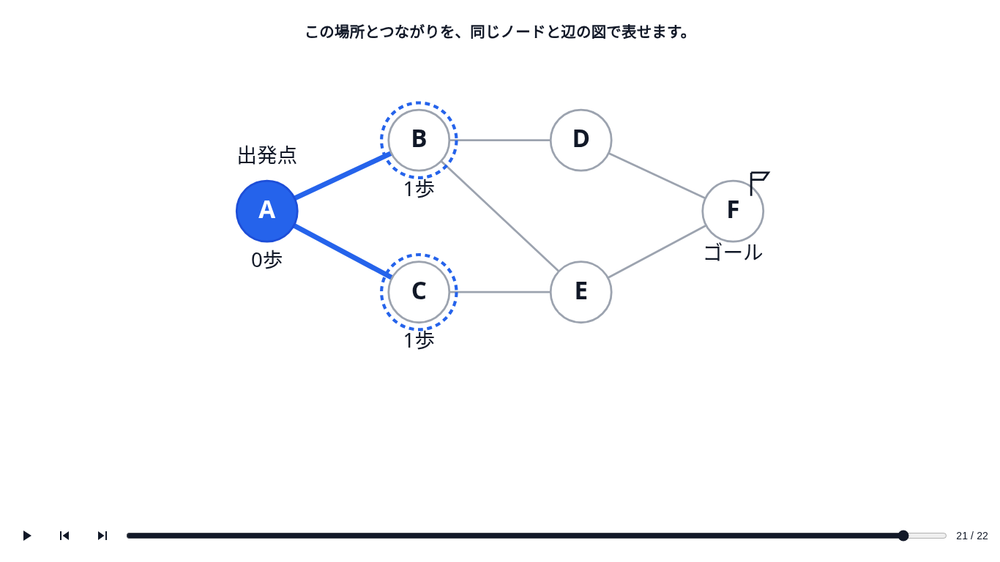 | 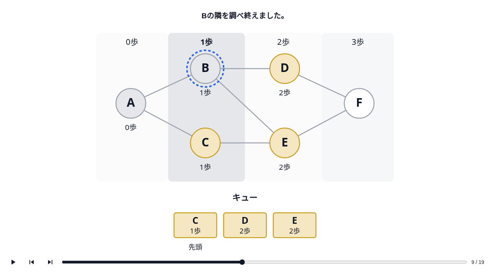 | 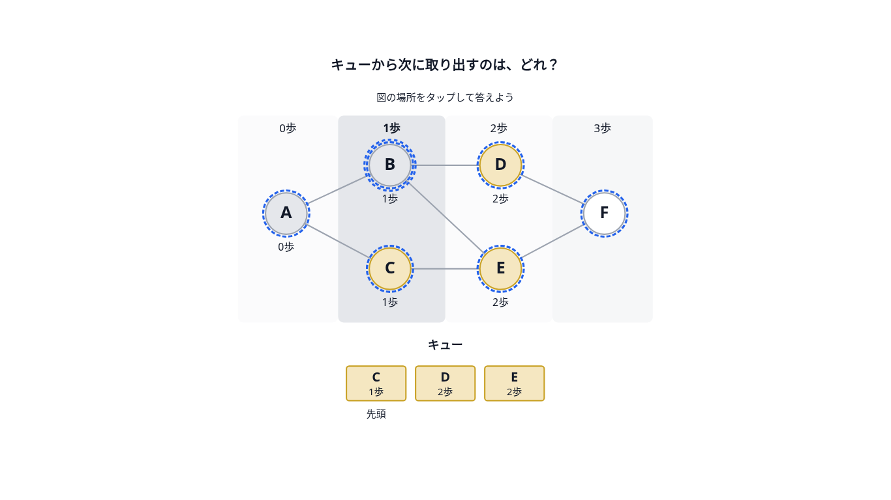 |
| 1920×1080 | 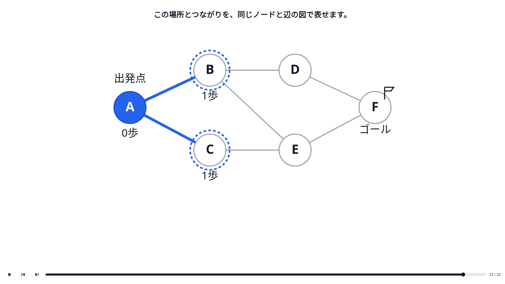 | 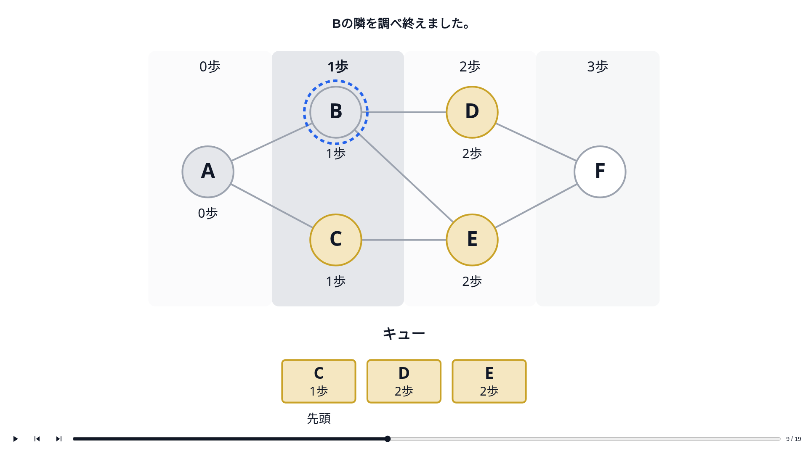 | 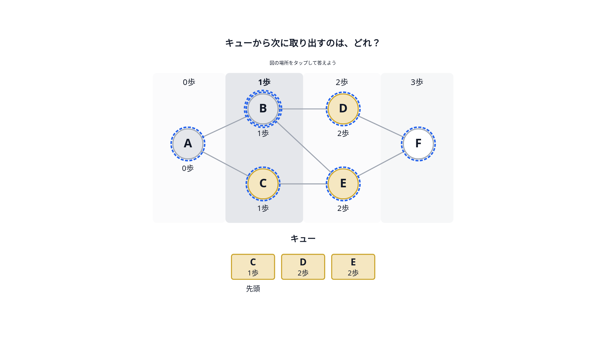 |
| 390×844 | 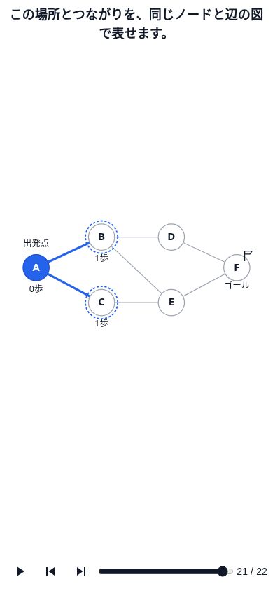 | 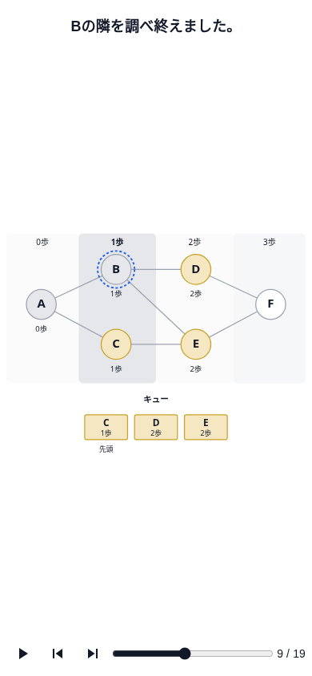 | 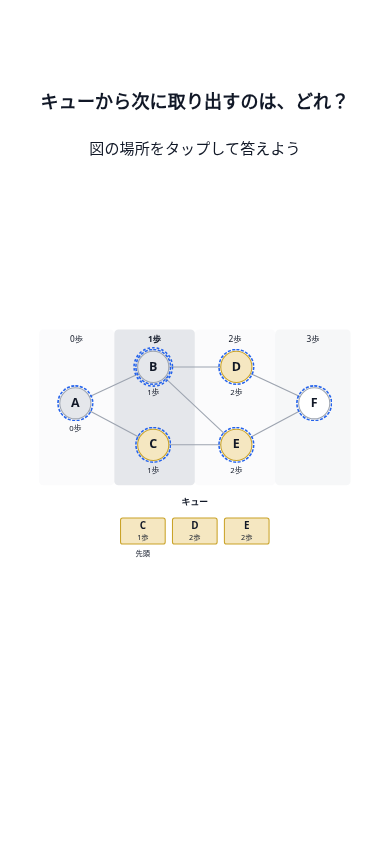 |

| 画面幅 | フェーズ1の直径(px) | フェーズ2 | フェーズ3（既存の小さい外枠） |
| --- | --- | --- | --- |
| 1366 | 83.02 | 83.02 | 63.62 |
| 1920 | 121.52 | 121.52 | 95.24 |
| 390 | 37.40 | 37.40 | 31.16 |

すべての幅・フェーズで、A→Bの横間隔／ノード直径=2.5、縦間隔／直径=70/60。線幅もSVG内で同一倍率となる。

迷路は3コマ目（ルート比較）と11コマ目（ラベル付きA→B→D）を比較する。

| 画面 | 5手・3手のルート | A→B→Dの線とラベル |
| --- | --- | --- |
| 1366×768 | 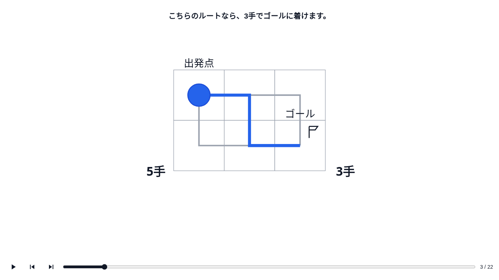 | 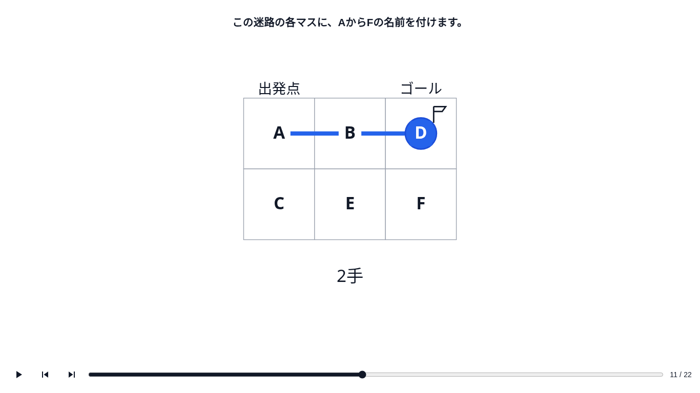 |
| 390×844 | 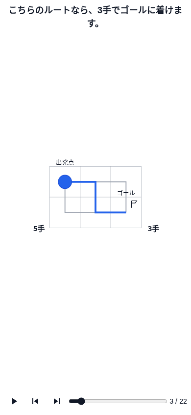 | 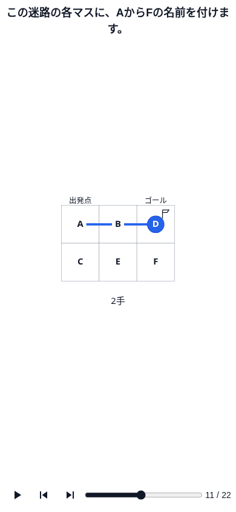 |
