# Issue #109 単元画面・学習画面・ホーム接続

- 目的: repo内のBFS教材を、認証・進捗・学習ログに接続して通常のコース導線から学習できるようにする。
- 適用範囲: フロントエンドの単元レジストリ、入口、単元フローの任意ポート、下書き、ログ。状態: 実装記録。最終確認日: 2026-11-05。
- 起点: `develop` `416b244`（PR #112マージ済み）。ブランチ: `feat/learning-screens-109`。
- 正本: [AGENTS.md](../AGENTS.md)、[開発ルール](development-rules.md)、[UI/UX方針 §1・2](concept/app-ui-ux-guideline.md)、[Issue #78の設計・学習ログ](https://github.com/BeppuKanato/engineer-quest/issues/78)、[Issue #109](https://github.com/BeppuKanato/engineer-quest/issues/109)。APIの正本は[learning service](../back/src/service/learning.service.ts)と[router](../back/src/router/learning.router.ts)。

## 画面と進捗

- レジストリは `front/src/features/learning/app/unitRegistry.ts`。BFSのcourseIdを元の `bfsUnitPhases`・タイトル・描画種別へ対応づける。教材のコピーは作らない。
- `/courses` のカードを単元画面へ接続する。BFSの一覧上の状態・進捗も新APIから得る。他コースは通常の一覧を残し、単元画面・学習画面は「準備中」とする。
- `/courses/roadmap/[courseId]`: 7個の大きなアイコンボタン、色と完了印・状態ラベル、次のフェーズ上の選択済みマスコット、開始／再開ボタン。既存の共通ナビゲーションは維持する。
- 開始／再開はPOST start成功後にlearnへ移動する。GETのフェーズ順とCOMPLETEDから最初の未完了を選び、lastPhaseKeyだけでは再開位置を決めない。過去フェーズのアイコンからの明示的な復習は`?phase=...`で指定できる。未到達の指定は無視し、最初の未完了へ戻す。
- `/courses/roadmap/[courseId]/learn`: `BfsUnitPreview`へ初期フェーズ・到達範囲・完了一覧・保存済みsummaryを渡す。ヘッダーを除く残り領域を教材に使い、教材描画・色・プレイヤーの見た目は変えない。
- 各プレビューのonCompleteが渡した `BfsUnitPhaseSummary` をそのままPOST phase completeへ渡す。保存失敗時は先へ進まず、同じ回答状態を保って再試行できる。
- フェーズ7完了の保存後に最終リザルトを表示し、未保存の単元完了をPOSTする。単元完了の失敗もリザルト上で再試行できる。全フェーズ保存済み・単元未完了の再訪でも、この経路で単元完了を保存する。既に単元完了済みなら再送しない。
- ホーム最上部の「続きから始める」は、レジストリ内のIN_PROGRESS単元の画面へつなぐ。該当がなければコース一覧へ。進捗の取得失敗を「学習中なし」と誤表示せず、再試行と一覧へのリンクを出す。ホームの他の機能は残す。

## API・下書き

`front/src/api/learning.api.ts`に5本のAPIを集約する。全て既存fetcherを通り、Firebase ID tokenをAuthorizationヘッダで付ける。パスのIDをURLエンコードする。進捗GETは再訪ごとに取得し、更新後は既存のコース／ホーム／コレクション／実績キャッシュを失効させる。

APIの実装に合わせてawardedCardは省略とnullの両方を受ける。summaryの送信は変更せず、読込時だけ既知の型を検査する。認証切替・アンマウント後の古いGET応答を表示しない。

下書きは `engineer-quest:learning-code:<Firebase uid>:<courseId>` のlocalStorage。空の下書きも復元し、コースとユーザーを分離する。入力変更時に保存し、単元完了後も削除しない。保存できないブラウザでは警告を出して編集・学習は続けられる。下書き用のサーバーAPIは作らない。ただし実行時のコードスナップショットは、Issue #78指定の分析イベントとして送る。

## #111への報酬の受け渡し口

`LearningRun`が以下の状態を持つ。フェーズ完了と単元完了の双方のレスポンスをマージし、表示前に捨てない。

```ts
type LearningRewards = {
  awardedCards: readonly { phaseKey: string; card: AwardedCard }[];
  unlockedAchievements: readonly UnlockedAchievement[];
};
```

- `awardedCards`: APIの獲得順に末尾へ追加するキュー。カードIDで重複を避ける。
- `unlockedAchievements`: フェーズ中と単元完了時の両方から蓄積し、IDで重複を避ける。
- `LearningRewardsContext`／`useLearningRewards()` は `{ rewards, dismissAwardedCard(cardId) }` を提供する。#111は先頭カードの演出完了時にだけdismissを呼ぶ想定。今回、消費する処理や演出は置かない。
- `BfsUnitPreview`は同じrewardsを`UnitFinalResult`へ渡す。最終リザルトは任意の `renderRewards(rewards)` を受け取れる。#111はこの受け口、または上記Contextから実績表示を接続できる。

状態は学習画面の滞在中に保持する。リロード後の獲得済みカード・実績の一覧／演出再提示は#111側の表示設計の範囲である。

## 計装したイベント

共通キューは `front/src/lib/learningEvents.ts`。タブのsessionStorageでsessionIdを保ち、バッチ全体に付ける。各イベントにはclientTimestampと、同一ミリ秒の順序を区別するpayload.sequenceも付ける。連番はリロード後も継続する。

| イベント | 主なデータ |
| --- | --- |
| `unit_start` | 初回／再開、開始フェーズ、明示的な復習か。単元画面の開始操作、または未開始単元のlearn直接訪問 |
| `unit_view` / `unit_complete` | 学習画面の入室、再開フェーズ／単元完了の保存成功 |
| `phase_start` / `phase_dwell` | フェーズキー、可視滞在ms |
| `phase_complete` | フェーズキー、onCompleteのsummary |
| `phase_move` | 前進／復習、移動元・先、戻り先ごとの回数 |
| `phase_result_view` / `phase_result_dwell` | フェーズ3・5の結果表示・可視時間 |
| `unit_result_view` / `unit_result_dwell` | 最終リザルト表示・可視時間 |
| `player_step_view` / `player_step_dwell` | contentId、stepId、表示順、可視時間。復習・トレース再生も同じ通知口 |
| `player_action` | 再生／一時停止／seek、移動元・先stepId。前後ボタン・キーボード・スライダーも含む |
| `player_end_reached` / `player_end_action` | 最後のステップ到達、次へ操作 |
| `phase_choice` | フェーズ1の意思確認ボタン |
| `question_view` / `question_dwell` | questionId、論点タグ、コード穴埋めでは行の意味ID、可視時間 |
| `answer_attempt` | 選択したノード／チップ／Parsonsの並び、正誤、試行番号、初回か、タグ、行ID、前の回答または問題表示からの経過ms |
| `assessment_retry` / `assessment_complete` | 再試行番号、初回スコア・総数・論点別の初回結果。診断型は誤答も保持 |
| `review_view` / `review_dwell` | 任意復習を開いた設問、可視時間 |
| `diagnosis_view` / `diagnosis_dwell` | フェーズ6診断の初回スコア・表示・可視時間 |
| `implementation_run` | 種別test／trace、それぞれの回数、実行時点のコード |
| `implementation_test_result` | ケースIDごとの合否、syntax／runtime／mismatch／timeout。判定用の入出力は含めない |
| `implementation_complete` | テスト実行回数、4レベルのヒント回数 |
| `hint_open` / `hint_token_insert` | 開いたレベルと回数、L1から挿入したトークン |
| `trace_result` | 再生／最終状態、状態数、打ち切り／エラー／取得失敗。生の例外本文・stdoutは含めない |

送信は5秒間隔または20件。学習操作からはawaitしない。通常送信は失敗時に1回だけ軽く再送し、最大500件でメモリを制限する。非表示・pagehide・ルート離脱時は子ビューの滞在記録まで積んでから、保持済みtokenとfetch keepaliveで送る。sendBeaconは使わない（今回の明示指示をIssue #78・#109の旧記述に優先）。離脱時のkeepalive全体は56KBに収め、収まらないイベントは次の通常送信に残す。再送で重複する場合もsessionIdとsequenceを保つ。

可視滞在はvisibilitychangeで非表示時間を除外する。アプリで隠したフェーズのプレイヤーは進めず、表示中のステップだけを記録する。単品プレビューは通知口未指定で従来どおり動く。キー入力単位の分析ログ、アプリ全画面共通ログ（#78の1・6〜8）、フリー実行コンソール（#110）は今回対象外。

## 確認方法

前提: #112のAPI・migration・seedが対象の開発環境に用意され、公開済みBFSコースが存在すること。今回DB適用は行わない。ログイン・HEXAD回答済みの開発用アカウントを使う。

`front/`で依存を用意し、`NEXT_PUBLIC_API_BASE_URL=<バックエンドのURL>`を設定して`npm run dev`。API baseには既存fetcherが`/api`を付ける。

- ホーム: http://localhost:3000/home
- コース一覧: http://localhost:3000/courses
- BFS単元: http://localhost:3000/courses/roadmap/course-algorithm-breadth-first-search-v1
- BFS学習: http://localhost:3000/courses/roadmap/course-algorithm-breadth-first-search-v1/learn
- 単品確認: http://localhost:3000/learning-preview/bfs-unit

1. コース一覧のBFSから単元画面へ進む。7アイコンと次のマスコット、APIの完了数を確認する。他のコースでは準備中となる。
2. 開始し、フェーズ1→7を進める。フェーズ3・5のリザルト、フェーズ6の診断、任意復習と過去フェーズへの戻りを操作する。
3. 各完了時のphase completeが元のsummaryを送ることをNetworkで確認する。保存を失敗させると同じ画面で再試行できる。
4. 途中で単元画面へ戻り、再読込して再開する。最初の未完了フェーズの先頭となり、フェーズ7だけは入力した下書きを復元する。
5. フェーズ7でヒント・トレース・5テストを実行する。全通過後に単元完了APIが呼ばれる。リザルト後もlocalStorageの下書きは残る。
6. React DevToolsでLearningRunのrewards、UnitFinalResultの同名propsを確認する。フェーズで出たカードと実績、単元完了で出た実績が残る。演出・提示は#111で実装する。
7. events/batchのAuthorization・sessionId・sequence・内容を確認する。タブ非表示、復帰、離脱を試し、keepalive送信と可視時間を確認する。通信失敗でも回答・編集を止めない。
8. ホーム最上部から学習中の単元に戻れること、未開始なら一覧へ進むことを確認する。390px幅でも操作する。

## 検証

lint、typecheck、build、既存verify全10本（learning-player＋BFS9本）と新しい`verify:learning-screens`の計14コマンドはすべてexit 0。追加verifyは認証APIのパス・summary、再開の穴、下書き分離、報酬キューと実績マージ、20件／5秒送信、連番、軽い再送、離脱時の子ビューcleanup、keepalive・バイト上限、可視時間を検証する。

ブラウザ確認はproduction build、1366×768・390×844で実施し、ページ内の例外なしを確認した。通常導線から7フェーズを完了し、保存失敗からの再試行、任意復習・誤答と再挑戦、フェーズ7の4ヒント・実トレース・実5テスト、最終リザルトへのカード3枚とフェーズ／単元両方の実績の受け渡しを確認した。別の再開操作でlocalStorageからの下書き復元、390pxの最初の未完了からの再開、準備中、進捗取得の失敗と再試行、未認証のリダイレクトも確認した。認証とAPIは既存のレスポンス契約を模したテスト応答で、保存後の状態を再訪時に返す。実DB・実アカウントを使ったAPI接続は本環境では未確認であり、上記手順で対象開発環境の確認が必要。CDN証明書の環境制約により実Monaco 0.54.0・実Pyodide 0.27.7は検証時のみ一時ローカル配信し、実際にPythonを実行する。実行・判定のスタブ化や、リポジトリのCDN設定変更はしない。

| 内容 | 画像 |
| --- | --- |
| ホームの入口 | 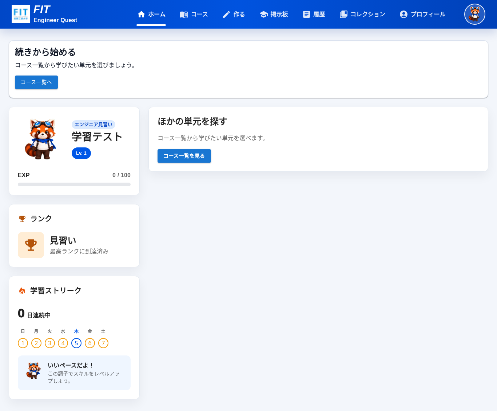 |
| 単元の未開始状態 | 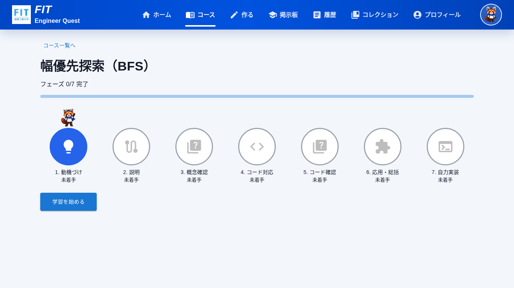 |
| 保存失敗と再試行 | 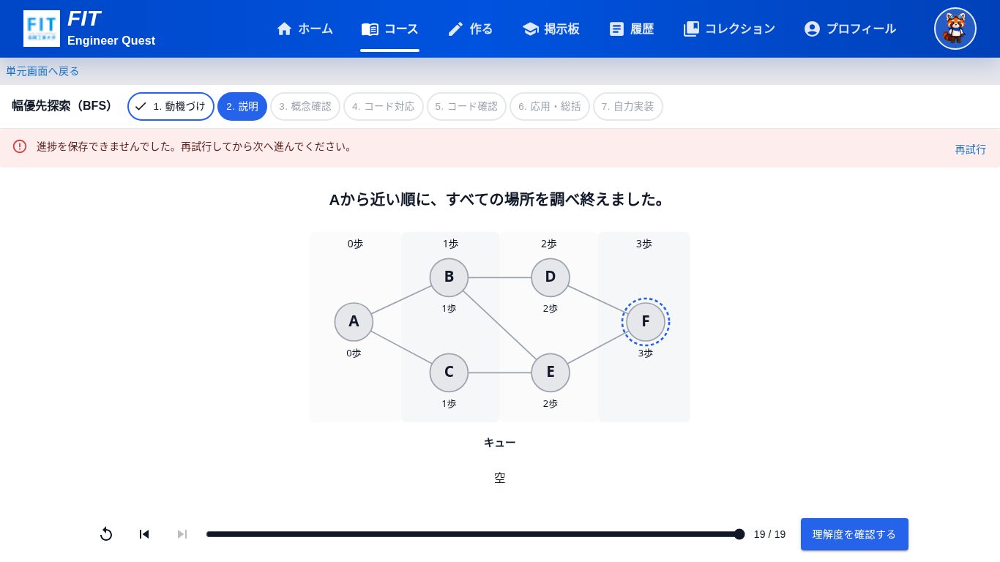 |
| フェーズのリザルト | 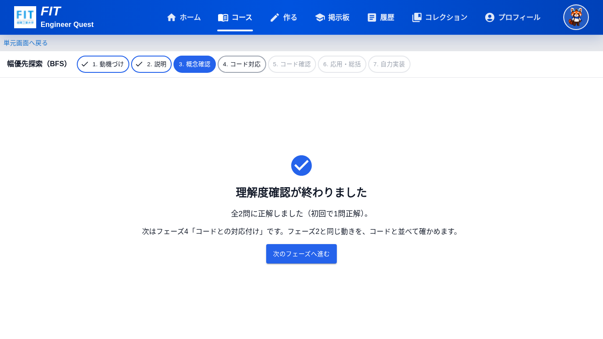 |
| フェーズ7から再開 | 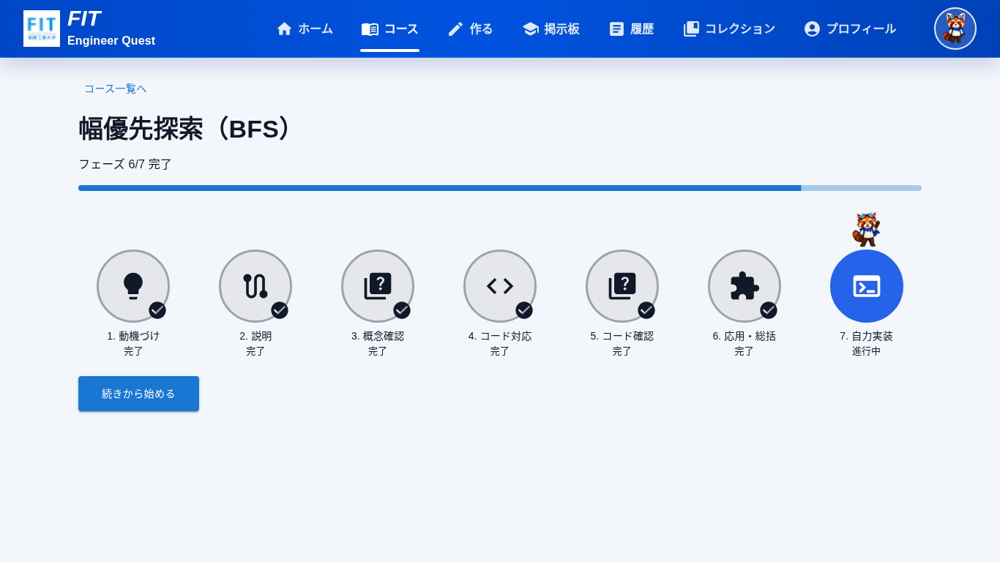 |
| 下書きの復元 | 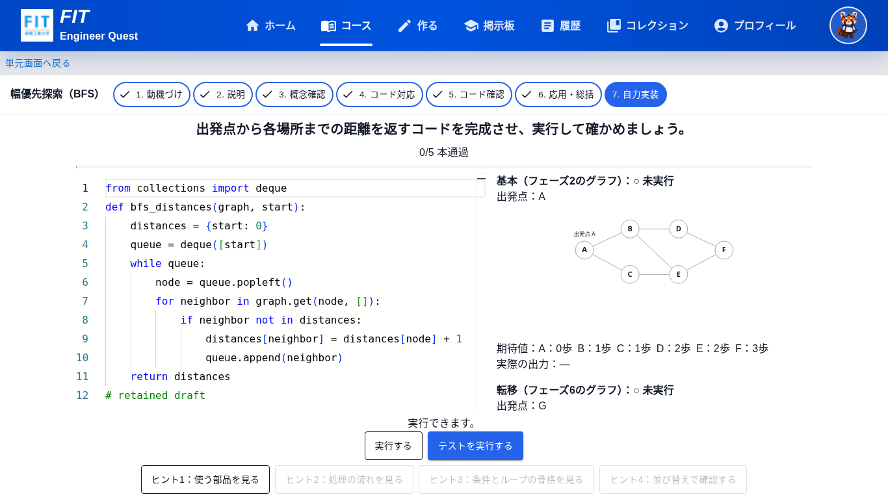 |
| 実コードのトレース | 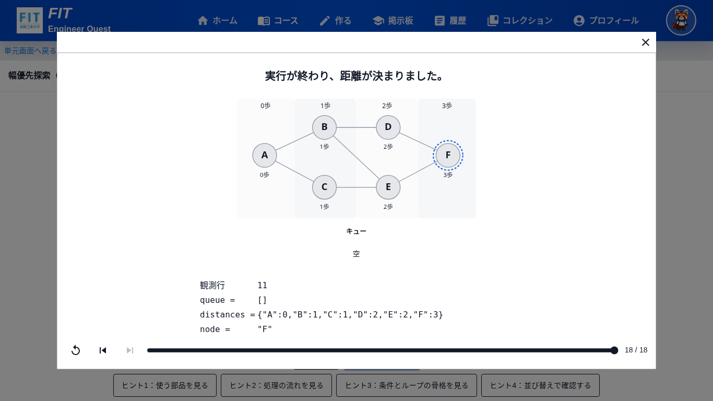 |
| 最終リザルト | 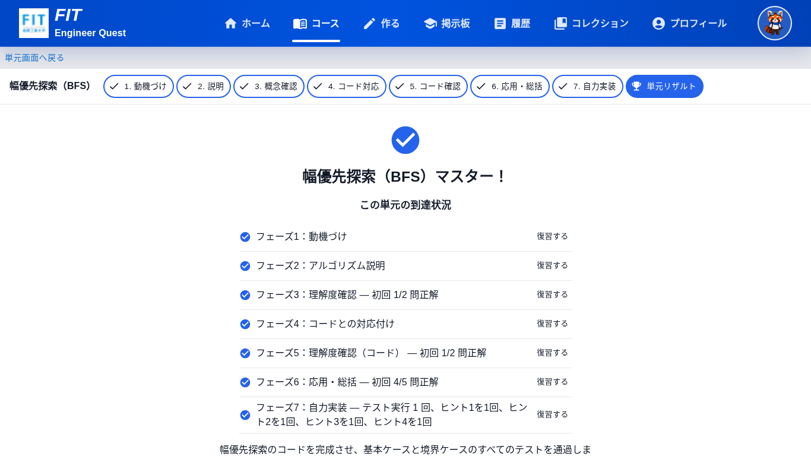 |
| 390pxの単元画面 | 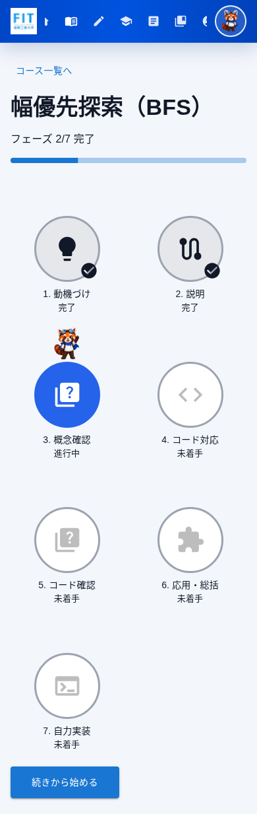 |
| 390pxの学習画面 | 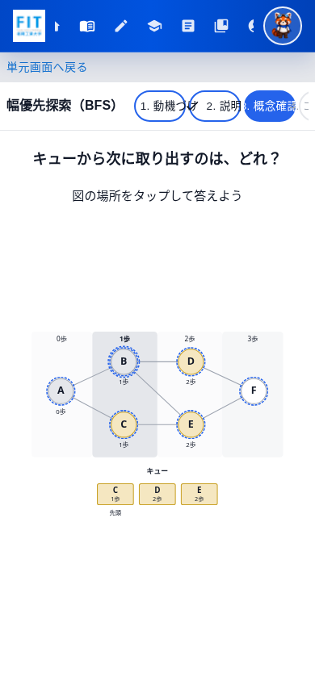 |
| 未実装単元 | 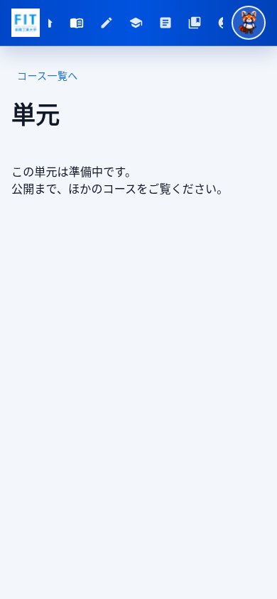 |

バックエンド・DB・教材content・bfsCode・プレイヤーの見た目・フィードバック層は変更しない。カード演出・実績提示（#111）、エディタ改善（#110）は対象外。
